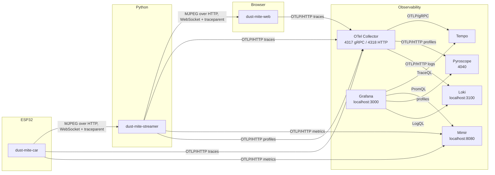

# Contributing to dust-mite

Contributions are welcome.
This repository is an experimental platform, and contributions that improve technical clarity, learning value, and iteration speed are prioritized.

## Ground rules

- Keep changes focused and easy to review.
- Prefer small pull requests over large rewrites.
- Preserve existing style and tooling unless a change explicitly updates them.
- Keep workflow steps and scripts thin: they run tools in sequence. Once one decides something, by branching or looping on data it reads, or passes about 100 lines, move its logic into tested Python in the area that owns it, or in `tools/<name>/` for repository tooling, and keep a thin entry point in `scripts/`. Scripts in `scripts/wizards/`, which the `/wizard` skill generates, are exempt. [ADR 0008](docs/adr/0008-complex-automation-logic-in-tested-python.md) explains why.
- Follow classical TDD: prefer real collaborators in tests. Where a real collaborator is impractical, use a hand-written stub, spy, or fake as described in [Test doubles](#test-doubles). Never use mocks or monkeypatching.
- Define a module-level constant only for a value that more than one place uses. Write a value that only one place uses where it is used. Two kinds of value stay at module level even when only one place uses them: a multi-line query string, such as a GraphQL document, and a compiled regular expression.
- Outside tests, use `isinstance` only on a value whose type the code does not own, such as parsed input, a third-party object or a caught exception. For the repository's own types, give the type a field or method that answers the question, or, over a closed union, use an exhaustive `match` that ends in `assert_never`, which mypy checks.
- Take a test's expected values from outside the code under test: a literal, or a named constant from a library or a standard. Never import an expected value from the code under test.
- In pytest, group a module's tests into one `Test<Unit>` class per function or class under test, for example `TestSelect` for `select()`. A class under test gets one nested class per method, for example `TestWriter.TestOutputs` for `Writer.outputs()`. Shared constants, builders, and doubles stay at module level. Name a builder, a function that returns test data, `make_<what it returns>`, for example `make_ticket()`.
- In pytest, write tests that share their steps and differ only in their data as one test with `@pytest.mark.parametrize`. Give each case a `pytest.param(…, id="…")` whose id reads like a test name, such as `id="skips a closed ticket"`. A case that sets up or checks something different keeps its own test.
- Fix every linter, formatter, and type-checker finding in the code instead of silencing it. Do not add inline suppressions (`# noqa`, `# type: ignore`, `// oxlint-disable…`, `// NOLINT`, `# shellcheck …`, `# zizmor: ignore[…]`, `# hadolint ignore=…`), new per-file or global ignores in tool configuration, or skip checks (`git commit --no-verify`, disabling or skipping a CI step). The only rule ignored for the whole repository in tool configuration is hadolint's DL3008, which asks for pinned apt package versions; [ADR 0006](docs/adr/0006-leave-apt-package-versions-unpinned.md) explains why.
- A suppression is acceptable only when the finding cannot be fixed because the code must match an interface outside the repository, such as a C extension's signature or a server that must bind to all interfaces. In that case, suppress the single rule on the single line and state the reason after it, for example `# noqa: S104 - the streamer must accept connections from all interfaces`, and list the suppression in the pull request description. actionlint has no inline form, so its suppression is a per-file `ignore:` pattern in [.github/actionlint.yaml](.github/actionlint.yaml) that matches only the one error, with the reason in a comment above it.
- Open or reference a GitHub Issue for bugs, tasks, and larger proposals.

## Test doubles

Test doubles follow the taxonomy from Gerard Meszaros, *xUnit Test Patterns*, summarized in Martin Fowler's [Mocks Aren't Stubs](https://martinfowler.com/articles/mocksArentStubs.html):

| Double | What it does |
|---|---|
| Dummy | Is passed around but never used. |
| Stub | Returns canned answers to the calls the test makes. |
| Spy | A stub that also records how it was used, for the test to check afterwards. |
| Mock | Is pre-programmed with expectations and verifies them itself. Not used in this repository. |
| Fake | A working, simplified implementation, such as an in-memory database. |

Rules:

- Name a double after its role, with the role as a suffix: `…Stub`, `…Spy`, `…Fake`, or `…Dummy`. Functions and C++ identifiers use `_stub`, `_spy`, `_fake`, or `_dummy`. A double that both returns canned answers and records calls is a spy.
- A double may subclass the real type when the interface is untyped or C-backed. Name it by the role it plays.
- Doubles that only tests use live under `tests/`, not `src/`. Put a double in `src/` only if it is a product feature, such as a car simulator.
- Doubles shared by several test modules live in a `test_doubles.py` next to those tests, with `__test__ = False` at module level so that pytest does not collect it.
- Use hand-written doubles only: no `unittest.mock`, `pytest` `monkeypatch`, `vi.mock`, `vi.spyOn`, `vi.stubGlobal`, `vi.stubEnv`, gmock, or CMock. Inject the collaborator, setting, or environment mapping instead.
- Names from third-party APIs, such as Vitest `vi.useFakeTimers` and OpenTelemetry `InMemoryMetricReader`, are exempt from the naming rule.

These rules are documented only; no linter enforces them.

## Issue labels

Every issue should carry one type label and at least one component label.

- **Type** — `bug`, `enhancement`, `documentation`.
- **Component** — `web`, `camera`, `telemetry`, `infrastructure`, `observability`, `drive`, `teleop`. Each names a functional subsystem, not a root directory, so a subsystem can move between [car/](car/) and [controller/](controller/) across variants without invalidating its label.

An issue or pull request that waits for a car agent session also carries `needs-car:<variant>`. A `needs-car` label exists only for a variant whose firmware is in the repository, which today is `needs-car:copper`. A label created for another variant also needs the variant added to the `car_variant` enum in [afk-run-output.schema.json](.github/afk-run-output.schema.json), [afk-run-pr-output.schema.json](.github/afk-run-pr-output.schema.json) and [afk-update-branch-output.schema.json](.github/afk-update-branch-output.schema.json). [DUT run](#dut-run) describes how a DUT run of such an item starts.

See each label's description on the [GitHub labels page](https://github.com/ltowarek/dust-mite/labels) for what it covers.

Don't add a new label without a recurring, evidenced need — an unused label is noise.

## DUT run

A DUT run of an issue or pull request labelled `needs-car:<variant>` starts with one command on the host, with the car connected, from the main checkout:

```bash
./scripts/run_dut_tests.sh
```

The script runs every DUT-gated test, each suite through its area's own test runner, in this order: the car's tests in a one-off C++ devcontainer, the controller's DUT integration tests in a one-off Python devcontainer, the full-stack tests in the headless stack's `test-runner`, after `npm ci` there installs the web's packages, and the observability E2E tests in a one-off Observability devcontainer. It starts the headless stack after the controller's tests, stops at the first failing suite with a non-zero exit status, and, once it has started the headless stack, always stops it on exit. The one-off containers run under the project name `dust-mite-dut`, rebuild their images first, and publish no ports, so they leave the editor's devcontainers untouched. The car's tests leave the debug build flashed.

A DUT run does not work from a git worktree. A worktree's `.git` file points to a host path that the containers do not mount, so the controller's version, the streamer's image and the car's firmware version cannot read the git metadata. Only one car is connected, so only one DUT run happens at a time; check out the branch under test in the main checkout instead.

## Prerequisites

- Docker
- VS Code with Dev Containers support

## Initial setup

From repository root:

```bash
./scripts/install_git_hooks.sh
./scripts/link_devcontainer_env.sh
```

`install_git_hooks.sh` installs a Git pre-commit hook that can run project checks.
The hook delegates to container-specific pre-commit scripts via `PRE_COMMIT_SCRIPT` configured in each devcontainer.

`link_devcontainer_env.sh` links each devcontainer's `.env` to the root `.env` (see [Development environment](#development-environment)).

[.claude/settings.json](.claude/settings.json) enables Matt Pocock's skills plugin for Claude Code, but enabling a plugin does not download it. Install it once per clone:

```bash
claude plugin install mattpocock-skills@claude-plugins-official --scope project
```

To update the plugin, run:

```bash
claude plugin update mattpocock-skills@claude-plugins-official --scope project
```

Restart Claude Code, then bring [docs/agents/](docs/agents/) in line with the new version's seed templates by running this in Claude Code:

```text
/setup-matt-pocock-skills Don't change the issue tracker, the labels or the domain layout. Check docs/agents/ against the current seed templates and report the drift. Take the template text wherever it changed, keep this repo's own additions, and show me the diff before writing.
```

## Development environment

This project is designed to be developed in VS Code Dev Containers.
Use devcontainers as the default workflow for all contributions.
Define shared default VS Code settings in the relevant devcontainer configuration instead of local `.vscode/settings.json` files.

Available environments:

- [.devcontainer/python/](.devcontainer/python/) for [controller/](controller/) work (controller app and Raspberry Pi camera service code quality checks)
- [.devcontainer/cpp/](.devcontainer/cpp/) for [car/](car/) firmware work
- [.devcontainer/js/](.devcontainer/js/) for [web/](web/) frontend work (bundler, linter, formatter, local dev server)
- [.devcontainer/observability/](.devcontainer/observability/) for [observability/](observability/) work (datasource/pipeline config, synthetic and real-data pipeline tests)
- [.devcontainer/docs/](.devcontainer/docs/) for [docs/](docs/) updates (diagrams and image processing)
- [.devcontainer/infrastructure/](.devcontainer/infrastructure/) for GitHub Actions workflows and repository-level scripts (see [Infrastructure](#infrastructure))

Each devcontainer reads the root `.env` through its `.devcontainer/<name>/.env` symlink, so VS Code builds and runs every devcontainer except `docs` as the host uid. [scripts/link_devcontainer_env.sh](scripts/link_devcontainer_env.sh) creates these symlinks in each clone, and git ignores them. The script holds the list of devcontainers, so a new devcontainer must be added to that list. Without the symlinks, each devcontainer falls back to uid `1050`.

There is currently no dedicated Raspberry Pi devcontainer profile. Use the Python devcontainer for shared lint/type/test workflows, and run Raspberry Pi camera runtime validation directly on Raspberry Pi OS.

### Devcontainer ports alongside the headless stack

The Python and JS devcontainers use different host ports than the headless `python`/`js` services, so both can run at the same time:

| Service | Devcontainer (manual) | Main / headless |
|---|---|---|
| Python streamer, WebSocket | `ws://localhost:8767` | `ws://localhost:8765` |
| Python streamer, Camera stream | `http://localhost:8768/camera` | `http://localhost:8766/camera` |
| JS dev server | `http://localhost:5174` | `http://localhost:5173` |

Container-internal ports (`python:8765`, `python:8766`, `js:5173`) are unchanged. To point a host browser at the Python devcontainer's streamer directly, override `VITE_WS_URL=ws://localhost:8767` and `VITE_CAMERA_URL=http://localhost:8768/camera` — `.env` defaults to `8765` and `8766` for the headless/byobu workflows. The C++ devcontainer publishes no ports, so it has no conflict.

### Open the correct workspace in container

1. Open the repository in VS Code.
2. From repository root, generate [.env](.env):

   ```bash
   ./scripts/dump_env.sh
   ```

3. Edit [.env](.env) and provide correct values for your setup (for example Wi-Fi SSID/password and other required variables).
4. Open the target locally first in VS Code:
   - For [python.code-workspace](python.code-workspace), [cpp.code-workspace](cpp.code-workspace), [js.code-workspace](js.code-workspace), or [observability.code-workspace](observability.code-workspace):
     1. Run `File: Open Workspace from File...`.
     2. Choose [python.code-workspace](python.code-workspace) for [controller/](controller/) work, [cpp.code-workspace](cpp.code-workspace) for [car/](car/) work, [js.code-workspace](js.code-workspace) for [web/](web/) work, or [observability.code-workspace](observability.code-workspace) for [observability/](observability/) work.
   - For docs or infrastructure work: no additional action is required; continue with the repository root opened in step 1.
5. If you need hardware passthrough:
   - For the controller's `hidraw` device, manually uncomment the `devices:` entry in [.devcontainer/python/docker-compose.yml](.devcontainer/python/docker-compose.yml).
   - To flash the car from VS Code, add `../../docker-compose.car.yml` to `dockerComposeFile` in [.devcontainer/cpp/devcontainer.json](.devcontainer/cpp/devcontainer.json). See [The car's serial port](#the-cars-serial-port).
6. Run `Dev Containers: Reopen in Container` and choose the matching devcontainer (`Python`, `C++`, `JavaScript`, `Observability`, `Docs`, or `Infrastructure`).

The container image includes project dependencies and VS Code extensions required for that stack. On first open, the devcontainer installs the controller package into the virtual environment via `postCreateCommand`.

#### Rationale for VS Code workspace files

- A plain single-root workspace is not suitable for this repository layout when using the ESP-IDF extension. The extension expects the workspace root to match an ESP-IDF project structure (see the [ESP-IDF example project layout](https://docs.espressif.com/projects/esp-idf/en/latest/esp32/api-guides/build-system.html#example-project)).
- Pointing `workspaceFolder` directly to [car/](car/) enables reliable ESP-IDF tooling, but editing files at repository root (for example docs or devcontainer config) becomes terminal-only and inefficient.
- Using [cpp.code-workspace](cpp.code-workspace) keeps [car/](car/) as the active project while still exposing the repository root in the same VS Code session.
- Keep workspace files (for example [cpp.code-workspace](cpp.code-workspace) and [python.code-workspace](python.code-workspace)) at repository root. If a `.code-workspace` file is stored in a subfolder, Dev Containers cannot resolve that subfolder's parent as the shared directory.

## Full stack development session

[docker-compose.yml](docker-compose.yml) at the repository root combines all devcontainer and observability services into a single compose project using [extends](https://docs.docker.com/compose/how-tos/multiple-compose-files/extends/).

### The car's serial port

The car's serial port is set once, as `CAR_SERIAL_PORT` in `.env`, with the default `/dev/ttyACM0`. The port has the same path on the host and inside every container. The overlay [docker-compose.car.yml](docker-compose.car.yml) passes it to the `cpp` service as a device, and applies both to the root compose project and to the C++ devcontainer.

- The headless stack and the byobu session take the overlay, so both need the car connected. The headless serial monitor connects without resetting the car.
- The DUT run's one-off C++ container takes the overlay.
- The VS Code C++ devcontainer does not take the overlay, so it starts without the car. To flash from VS Code, add the overlay to its `dockerComposeFile`. `idf.port` reads `CAR_SERIAL_PORT`.

### Byobu session

[scripts/start_byobu.sh](scripts/start_byobu.sh) starts all containers and opens a terminal session with four panes in a 2×2 grid:

| C++ serial monitor | Python streamer |
|---|---|
| JS dev server (`http://localhost:5173`) | OTel Collector logs |

From the repository root:

```bash
./scripts/start_byobu.sh
```

Each pane runs its workload in the corresponding container via `docker compose exec`. Press `Ctrl-C` to cancel a running command; the pane drops into an interactive shell in the same container. The C++ pane is an exception: `idf_monitor.py` runs in raw terminal mode and forwards `Ctrl-C` to the ESP32 as a break signal. Use `Ctrl-]` to exit the monitor; the pane then drops into an interactive shell.

Build and flash are performed separately in the C++ devcontainer. Use the byobu C++ pane to observe ESP32 serial output during a full-stack session.

Basic byobu navigation:

| Key | Action |
|---|---|
| `F12 :kill-session` | Kill session and stop all containers |
| `F6` | Detach from session (containers keep running); reattach with `byobu attach-session -t dust-mite` |
| `F12` + arrow | Move between panes |
| `F12 z` | Zoom current pane to full screen (repeat to unzoom) |

See the [byobu documentation](https://www.byobu.org/documentation) for the full key reference.

## Observability



The observability stack covers distributed tracing, real-time metrics, continuous profiling, and logs. It comprises six tiers:

- **OTel Collector** (`otel/opentelemetry-collector-contrib`) — OTLP receiver on 4317 (gRPC) and 4318 (HTTP). Routes traces to Tempo, forwards profiles to Pyroscope, and forwards logs to Loki. Configuration: [observability/otelcol.yml](observability/otelcol.yml).
- **Grafana Tempo** — trace storage and query backend. Configuration: [observability/tempo.yml](observability/tempo.yml).
- **Grafana Mimir** (single-tenant) — metrics storage, exposing a Prometheus-compatible query API under `http://localhost:8080/prometheus`. Configuration: [observability/mimir.yml](observability/mimir.yml).
- **Grafana Pyroscope** (v2 architecture) — continuous profiling storage and query backend, exposed at `http://localhost:4040`. Configuration: [observability/pyroscope.yml](observability/pyroscope.yml). See [Profiling (firmware CPU)](#profiling-firmware-cpu) and [Profiling (Python streamer CPU)](#profiling-python-streamer-cpu) below. Ingestion is asynchronous — newly received profiles can take up to ~30-40 s to become queryable, unlike traces/metrics.
- **Grafana Loki** (single-tenant) — log storage, ingesting via its native OTLP endpoint at `http://loki:3100/otlp`. Resource attributes become index labels using Loki's default OTLP mapping (e.g. `service.name` → `service_name`), matching the label naming already used for Tempo/Mimir/Pyroscope. Configuration: [observability/loki.yml](observability/loki.yml).
- **Grafana** — visualization UI at `http://localhost:3000`. Tempo (default), Mimir, Pyroscope, and Loki datasources are auto-provisioned. A pre-built dashboard is available under **Dashboards → dust-mite**. Configuration: [observability/grafana/provisioning/](observability/grafana/provisioning/).

### Instrumented services

All three services export traces via OTLP/HTTP to the OTel Collector; the firmware and the streamer also export metrics directly to Mimir:

| Service | Name in Tempo | Traces endpoint | Metrics endpoint |
|---|---|---|---|
| ESP32 firmware | `dust-mite-car` | `CAR_OTEL_EXPORTER_OTLP_TRACES_ENDPOINT` (default `http://$CAR_OTLP_HOST:4318/v1/traces`) | `CAR_OTEL_EXPORTER_OTLP_METRICS_ENDPOINT` (default `http://$CAR_OTLP_HOST:8080/otlp/v1/metrics`) |
| Python streamer | `dust-mite-streamer` | `OTEL_EXPORTER_OTLP_TRACES_ENDPOINT`, else `OTEL_EXPORTER_OTLP_ENDPOINT` + `/v1/traces` (default `http://otel-collector:4318/v1/traces`) | `OTEL_EXPORTER_OTLP_METRICS_ENDPOINT` (default `http://mimir:8080/otlp/v1/metrics`) |
| Web browser | `dust-mite-web` | `VITE_OTLP_ENDPOINT` (default `http://localhost:4318`) | none |

The ESP32 cannot resolve the observability stack's Docker DNS names (e.g. `otel-collector`), so its endpoints must be the host machine's LAN IP rather than a container service name. Set that IP as `CAR_OTLP_HOST` when [scripts/dump_env.sh](scripts/dump_env.sh) generates `.env`. The script derives `CAR_OTEL_EXPORTER_OTLP_TRACES_ENDPOINT`, `CAR_OTEL_EXPORTER_OTLP_LOGS_ENDPOINT`, `CAR_OTEL_EXPORTER_OTLP_METRICS_ENDPOINT` and `CAR_OTEL_EXPORTER_OTLP_PROFILES_ENDPOINT` from it. Each is a full URL, like the streamer's `OTEL_EXPORTER_OTLP_*_ENDPOINT`. The C++ devcontainer passes the four URLs to the firmware build, which [car/main/main.cpp](car/main/main.cpp) uses for its exporters, in the same way that `WIFI_SSID` reaches the firmware. The build reads these URLs when CMake configures, so after changing `CAR_OTLP_HOST` run `idf.py reconfigure` or `idf.py fullclean` before the next build.

The firmware's logs endpoint reuses the same collector URL as traces, not the metrics bypass-to-Mimir pattern — see [Logs](#logs) below.

### Metrics

The set of emitted metrics is variant-specific. See the variant documentation in [docs/variants/](docs/variants/) for the full list. When adding or removing a metric, update the metrics table in the relevant variant document. Metric names use underscores (`dust_mite_rssi`), not dots — Mimir's OTLP ingestion normalizes dots to underscores at write time, and its PromQL grammar rejects dotted names outright at query time, so instrumentation, dashboards, and tests all use the underscore form to match what's actually queryable.

To verify the metrics pipeline is working:

```bash
# Query Mimir (populated once metrics are being emitted); Mimir's Prometheus-
# compatible API is mounted under /prometheus:
curl -s 'http://localhost:8080/prometheus/api/v1/query?query=up' | python3 -m json.tool

# Check a specific firmware metric:
curl -s 'http://localhost:8080/prometheus/api/v1/query?query=dust_mite_task_cpu_usage' | python3 -m json.tool
```

### Logs

The Python controller package bridges its existing standard-library `logging` output into OTel
rather than introducing a separate structured logging vocabulary. `configure_logging(endpoint, resource)` in
[controller/src/controller/logging.py](controller/src/controller/logging.py) attaches an
`opentelemetry-instrumentation-logging` `LoggingHandler` to the root logger, so every existing
`logging.getLogger(...)` call site is bridged with no change to call sites. Both
`controller.py` (the Terminal app) and `streamer.py` (always-on service) set it up, with every other
signal, through `configure_observability`. Log records share the resource tracing uses, and route
through the same collector as traces, at `OTEL_EXPORTER_OTLP_LOGS_ENDPOINT`, else
`OTEL_EXPORTER_OTLP_ENDPOINT` + `/v1/logs` (not the metrics bypass-to-Mimir pattern). The
`LoggingHandler` is constructed with `log_code_attributes=True`, which is off by default: without it records reach Loki with no `code.*`
attributes, so nothing there says which call site produced a line.

Logging is configured once, in `configure_logging`, before the other signals. It sets the `controller`
package logger to `DEBUG` and attaches a console handler named `console` to the root logger, whether or not a logs
endpoint is set. The Terminal app finds that handler with `logging.getHandlerByName("console")` for its curses console logging. Modules only
call `logging.getLogger(__name__)`; none sets its own level or calls `basicConfig()`. The root logger
stays at `WARNING`, so third-party libraries such as `websockets` and `aiohttp` send only `WARNING`
and above. The exception is the Terminal app: importing `pydualsense` sets the root logger to `INFO`
and attaches its own console handler. The Raspberry Pi camera service runs without OpenTelemetry and calls
`logging.basicConfig(level=logging.DEBUG)` in its `__main__` block instead.

The web frontend has no existing logging to bridge, so `setupLogging()` in
[web/src/logging.js](web/src/logging.js) initializes a `LoggerProvider` directly, matching the
resource-attribute pattern of the existing `WebTracerProvider`/`MeterProvider` and routing through
the OTel Collector like traces. It emits a `DEBUG` handshake record on every page load as a
steady-state signal, plus two purposeful call sites: a global uncaught-error handler and the
WebSocket connection logic's abnormal-close handler. The WebSocket `error` event isn't logged on
its own, since the `close` event that always follows it carries the actual diagnostic detail.

The ESP32 firmware bridges its existing `ESP_LOG` call sites the same way the Python controller
bridges `logging`: no change to call-site text or levels. `esp_log_otel.h`, from the
[esp-opentelemetry-cpp](https://github.com/ltowarek/esp-opentelemetry-cpp) fork
([car/components/esp-opentelemetry-cpp](car/components/esp-opentelemetry-cpp)), redefines
`ESP_LOGE`/`W`/`I` to also feed the OTel logger `esp_opentelemetry_logs_setup()` installs in
[car/main/main.cpp](car/main/main.cpp); it's included by each firmware `.cpp` that has call sites
to ship ([camera.cpp](car/components/camera/camera.cpp),
[web_server.cpp](car/components/web_server/web_server.cpp),
[motor.cpp](car/components/motor/motor.cpp), [wifi.cpp](car/components/wifi/wifi.cpp),
[telemetry.cpp](car/components/telemetry/telemetry.cpp)). `ESP_LOGD`/`V` are not wrapped — they're
already compiled out of this build (`CONFIG_LOG_MAXIMUM_LEVEL` follows the default `Info` level),
matching what the fork's macro deliberately excludes. Reuses the same `vcs.*` resource attributes
tracing/metrics already build in `main.cpp`, routed to the same collector endpoint as tracing
(`CAR_OTEL_EXPORTER_OTLP_LOGS_ENDPOINT`).

One structural gap: `esp_opentelemetry_logs_setup()` must run after `sync_time()` (SNTP) or every
record is stamped 1970 and Loki drops it — but `wifi_setup()`'s own `ESP_LOGI(TAG, "wifi_init_sta
finished.")` and `telemetry.cpp`'s SNTP call sites necessarily run *before* both, so those specific
lines are never exported, only ever seen on the serial console. Every call site reached once
Wi-Fi/time are up (which is nearly all of them) ships normally.

Batch sizing (`CONFIG_ESP_OPENTELEMETRY_LOGS_BATCH_MAX_QUEUE_SIZE` /
`..._SCHEDULE_DELAY_MS`) is left at the fork's defaults (128 / 5000 ms), consistent with how
tracing/metrics are configured in `car/sdkconfig.defaults` — neither overrides its own batch
settings either. A sustained burst of INFO logs (e.g. continuous driving, which logs once per
received command in both `web_server.cpp` and `motor.cpp`) can exceed that and drop excess
records; the drop is silent and non-blocking by design, not a correctness bug.

### Cross-service trace propagation

W3C `traceparent` is embedded as a field in every JSON WebSocket message, linking spans across the firmware → streamer → browser path:

- Firmware: `tracing_inject()` / `tracing_extract()` in [car/components/tracing/tracing.hpp](car/components/tracing/tracing.hpp).
- Streamer: `inject_trace_context()` / `extract_trace_context()` in [controller/src/controller/tracing.py](controller/src/controller/tracing.py).
- Browser: `@opentelemetry/api` propagation via W3C `TraceContextPropagator` in [web/src/index.js](web/src/index.js).

### Adding spans

**ESP32 firmware (C++)** — use `esp_opentelemetry_tracer()` from `car/components/tracing/tracing.hpp`:

```cpp
// Simple span
auto span = esp_opentelemetry_tracer()->StartSpan("my.operation");
span->SetAttribute("key", "value");
span->End();

// Span linked to a parent extracted from an incoming JSON WebSocket message
auto parent_ctx = tracing_extract(*json_obj);
opentelemetry::trace::StartSpanOptions opts;
opts.parent = opentelemetry::trace::GetSpan(parent_ctx)->GetContext();
auto span = esp_opentelemetry_tracer()->StartSpan(
    "my.operation", {{"attr", value}}, opts);
auto scope = opentelemetry::trace::Scope(span);
// ... work ...
span->End();
```

**Python streamer** — give each module its own `tracer = trace.get_tracer(__name__)`, as `streamer.py`, `car.py`, `command_arbiter.py` and `vision.py` do, and use the helpers from `controller/src/controller/tracing.py`:

```python
# Decorator — span wraps the entire function
@tracer.start_as_current_span("my.operation")
def my_function():
    span = trace.get_current_span()
    span.set_attribute("key", "value")

# Span linked to a parent extracted from an incoming JSON WebSocket message
message: dict = json.loads(raw_message)
parent_ctx = extract_trace_context(message)  # reads W3C traceparent from the dict
with tracer.start_as_current_span("my.operation", context=parent_ctx) as span:
    span.set_attribute("key", "value")
```

**Web browser (JavaScript)** — use the module-level `tracer` and `propagation` from `web/src/index.js`:

```js
// Span linked to a parent extracted from an incoming JSON WebSocket message
const carrier = { traceparent: message.traceparent, tracestate: message.tracestate };
const parentContext = propagation.extract(context.active(), carrier);
const span = tracer.startSpan("my.operation", {
    attributes: { "key": "value" },
}, parentContext);
try {
    // ... work ...
} finally {
    span.end();
}
```

### Viewing metrics

Open Grafana at `http://localhost:3000` → **Dashboards** → **dust-mite**. The dashboard shows all sensor readings and pipeline counters at 1 s resolution.

### Viewing traces

Open Grafana at `http://localhost:3000` → **Explore** → select the **Tempo** datasource → run a TraceQL query:

- `{}` — all traces
- `{resource.service.name="dust-mite-car"}` — firmware spans only
- `{resource.service.name="dust-mite-streamer"}` — streamer spans only

### Viewing logs

Open Grafana at `http://localhost:3000` → **Explore** → select the **Loki** datasource → run a LogQL query. Unlike Tempo's `resource.service.name`, Loki's stream label is `service_name` (dots already normalized to underscores):

- `{service_name="dust-mite-car"}` — firmware logs only
- `{service_name="dust-mite-streamer"}` — streamer logs only
- `{service_name="dust-mite-controller"}` — Terminal app logs only
- `{service_name="dust-mite-web"}` — browser logs only

In a Tempo trace view, a span carries a **Logs for this span** link that jumps straight to the matching Loki lines by `trace_id`.

### Profiling (firmware CPU)

Spans and metrics tell you *which component* is slow; the statistical profiler tells you
*which code* is burning CPU on the ESP32-S3, so you can decide between optimising the code,
changing FreeRTOS scheduling (core/priority), or accepting a hardware limit. It is a sampling
profiler exported as the OpenTelemetry **profiles** signal and viewed as Grafana **Pyroscope**
flame graphs.

For how the sampler, exporter, and symbolizer work internally, see the
[esp-opentelemetry-cpp README](https://github.com/ltowarek/esp-opentelemetry-cpp/blob/main/README.md#esp-specific-integrations).

To profile a build:

1. Bring up the stack (`./scripts/start_headless.sh`) — it includes `pyroscope` and
   `profiling-symbolizer`.
2. Build the firmware with the debug overlay (enables the sampler, the
   span→profile task slot, and the symbolizer endpoint; see
   [car/sdkconfig.defaults.debug](car/sdkconfig.defaults.debug)), then flash it:
   `./scripts/run_build.sh --debug . && idf.py flash`
   Symbols need no publishing step: the symbolizer mounts `car/` and finds the
   matching ELF by hash (the profile `build_id` equals the ELF's sha256) in `build/` or any
   `build_<overlay>/`, for the firmware and the component test apps.
3. Open Grafana → **Explore** → **Pyroscope** datasource. Filter by
   `{service_name="dust-mite-car"}`, optionally split by `thread_name` (FreeRTOS task). Idle
   task dominance means the workload is not CPU-bound (hardware/scheduling limited); a specific
   application or esp-idf frame dominating means there is code to optimise.

QEMU is not used to read profiles — its Xtensa core is not cycle-accurate, so durations would be
fictional. The sampler/span-link/exporter mechanics are covered by
[esp-opentelemetry-cpp](https://github.com/ltowarek/esp-opentelemetry-cpp/blob/main/README.md#esp-specific-integrations)'s
own CI (QEMU), including a regression test for the profile export starving the tasks around it of
internal RAM, the only memory FreeRTOS objects, lwIP sockets and DMA buffers can use. dust-mite's
CI builds the car with the debug overlay (`main-debug`), and the smoke test (see
[Car test types](#car-test-types)) runs it on the car.
Flame graphs themselves are validated on real hardware only.

#### Span profiles (trace → flame graph)

Profiles are linked to traces the same way Go/Python do it; see `esp_task_span_slot.cpp` in the
[esp-opentelemetry-cpp README](https://github.com/ltowarek/esp-opentelemetry-cpp/blob/main/README.md#esp-specific-integrations)
for the mechanism. No changes are needed at span call sites.

In a Tempo trace view, spans carry a **Profiles for this span** link/flame-graph tab
(provisioned via `tracesToProfiles` on the Tempo datasource) showing the CPU sampled while
that exact span was active. Spans are also stamped with the `pyroscope.profile.id` attribute
Grafana uses to enable the embedded flame graph.

Expectations: at 100 Hz/core a 5 ms span catches at most one sample — per-span flame graphs
are meaningful for spans of tens of milliseconds or when aggregated across many span
instances. Raise `CONFIG_ESP_OPENTELEMETRY_PROFILING_SAMPLE_HZ` for a session if finer coverage is needed.

### Profiling (Python streamer CPU)

Same rationale as the firmware section above: spans and metrics tell you *which component* is
slow, the profiler tells you *which code*. Unlike the firmware, this goes through the
[OpenTelemetry profiles signal](https://opentelemetry.io/docs/concepts/signals/profiles/) end
to end — a real in-process sampler and OTLP profiles exporter posting directly to the same
OTel Collector `profiles` pipeline the firmware uses (no symbolizer hop needed: Python
function names/line numbers are already human-readable at sample time).

The generic sampler/aggregator/exporter live in `controller/src/otlp_profiler/` (no dust-mite
imports, so it can move into its own package later with no code changes); the dust-mite wiring —
deciding whether to start it and which source-linking attributes to attach — is
`controller/src/controller/profiling.py`, called from `configure_observability` in
`controller/src/controller/observability.py` with the rest of the signals.

Exports as real protobuf (not JSON) directly to the collector's OTLP receiver — the observability
stack's collector/Pyroscope versions are pinned specifically so `opentelemetry-proto`'s generated
classes are wire-compatible. Its `sample_type`/`period_type` are both `samples`/`count`, matching
the ESP32 firmware's own choice, so both languages share one Pyroscope profile type
(`samples:samples:count:samples:count`) and one `tracesToProfiles` datasource config. By default
it exports every 500 ms and, when the process exits, once more for the window still open.

The sampler filters samples to threads Linux reports as **running** (`R` state) at sample time,
read from `/proc/<tid>/stat` — a thread parked in `socket.recv()` between messages is excluded,
rather than counted on every tick it's blocked. It's a Linux-only mechanism, which matches this
project's deployment (`controller/Dockerfile` is `python:3.12-bookworm`) — there's no non-Linux
code path to preserve. It's still a point-in-time state check read a few microseconds after the
stack snapshot, not a computed CPU-time delta, and it doesn't factor in GIL ownership — a thread
contending for the GIL is typically in `S` state and gets filtered out even though it's using CPU.
See `controller/src/otlp_profiler/sampler.py`'s module docstring for the full detail.

Profiling is on whenever the profiles endpoint is set, like tracing and logs. Profiles go to
`OTEL_EXPORTER_OTLP_PROFILES_ENDPOINT`, else `OTEL_EXPORTER_OTLP_ENDPOINT` +
`/v1development/profiles`: the profiles signal is still in development, so the pinned collector
serves it under the development version rather than `v1`. The headless stack's streamer therefore
always profiles ([ADR 0007](docs/adr/0007-streamer-always-profiles-car-profiles-in-debug-build.md)).

To profile a run:

1. Bring up the stack (`./scripts/start_headless.sh`).
2. Open Grafana → **Explore** → **Pyroscope** datasource. Filter by
   `{service_name="dust-mite-streamer"}`, optionally split by `thread_name`. Splitting by thread
   name separates the event loop, which serves every connection, from worker threads such as those
   processing Camera frames; it does not separate one connection from another.

#### Span profiles (trace → flame graph)

Every span (not just the root span of a trace) is stamped with a `pyroscope.profile.id`
attribute, so any streamer span in Tempo's trace view can show a **Profiles for this span**
flame graph scoped to exactly that span's duration — including nested spans. On an asyncio event
loop, a sample is linked to the span of the task the loop was running; a sample taken during a plain
loop callback, outside any task, is not linked to a span.

Same sample-rate physics as the firmware: at 100 Hz a span of only a few milliseconds will catch
zero or one sample. Per-span flame graphs are meaningful for spans of tens of milliseconds or
longer, or aggregated across many instances of the same span — an empty flame graph on a very
short span is an expected consequence of the sampling interval.

### Source-code linking (GitHub)

Pyroscope's [source-code integration](https://grafana.com/docs/pyroscope/latest/view-and-analyze-profile-data/line-by-line/)
shows the actual GitHub source line next to a sampled frame in a flame graph's Function Details
panel, instead of just a function name. It requires two things: profiling data tagged with three
resource attributes, and a self-hosted Pyroscope server configured with a GitHub OAuth App.

**Resource attributes.** `service_repository` and `service_git_ref` are mandatory;
`service_root_path` is optional (the subtree within the repository where a given service's code
lives).

- **Python streamer**: `service_repository` comes from the `SERVICE_REPOSITORY` env var, catalogued
  in `scripts/dump_env.sh`; `service_root_path` is fixed to `controller` in
  [controller/src/controller/profiling.py](controller/src/controller/profiling.py).
  `service_git_ref` comes from the installed `controller` package's own version (`setuptools_scm`,
  derived from git at `pip install .` time) rather than an env var, so it can't go stale relative
  to `.env`. `controller/Dockerfile` bind-mounts `.git` for that one
  install step only, via `additional_contexts: {root: .}` in `docker-compose.yml`.
- **Car firmware**: `service_repository`/`service_root_path` are static Kconfig options, set in
  `car/sdkconfig.defaults`. `service_git_ref` comes from ESP-IDF's own `esp_app_desc_t.version`
  (`git describe` at build time), read via `esp_git_ref.cpp`. Confirmed working on real hardware.

**Path mapping.** Frames carry the absolute path baked in at build time (the container's install
or build path), not a repo-relative one, so per-line source display additionally needs a
`.pyroscope.yaml` translating one to the other. `controller/.pyroscope.yaml` and `car/.pyroscope.yaml`
do this; Pyroscope fetches them from the pushed GitHub ref, so they take effect only once committed
and pushed, not from a local checkout.

`.pyroscope.yaml`'s `language` field only documents `go`/`java`/`python`/`javascript`; there's no
documented value for C++, so `car/.pyroscope.yaml` uses `cpp`, which is unconfirmed.

**GitHub App setup (manual, one-time).** Pyroscope's self-hosted GitHub integration still requires
a GitHub OAuth App even for a public repository — the "Connect to GitHub" flow in the Function
Details panel runs regardless of repository visibility. The only simplification a public repo
gets is that the App needs no extra permissions (no Contents/Metadata read scopes).

1. GitHub → **Settings** → **Developer settings** → **GitHub Apps** → **New GitHub App**.
   Callback URL: `http://localhost:3000/a/grafana-pyroscope-app/github/callback` (adjust the host
   if Grafana is reached differently than this repo's documented `http://localhost:3000`).
2. Generate a client secret for the App.
3. Set the three secrets and regenerate `.env`, preserving existing values:

   ```bash
   source scripts/load_env.sh && GITHUB_CLIENT_ID=<id> GITHUB_CLIENT_SECRET=<secret> \
     GITHUB_SESSION_SECRET=$(openssl rand -hex 32) ./scripts/dump_env.sh
   ```

   `GITHUB_SESSION_SECRET` has no auto-generated default in `dump_env.sh` for the same reason
   `service_git_ref` avoids `.env`: a computed default would silently mint a fresh secret — and
   invalidate every existing Pyroscope OAuth session — on any unrelated `dump_env.sh` run.

**Verification.** Grafana → **Explore** → **Pyroscope** → `{service_name="dust-mite-streamer"}` →
open a flame graph → click a frame → **Function Details** should show the GitHub source line
inline.

### Observability tests

In the Observability devcontainer, the workspace opens at `/workspaces/dust-mite/observability`.

```bash
./scripts/run_checks.sh
./scripts/run_tests.sh
```

Two test tiers:

- **[observability/tests/integration/](observability/tests/integration/)** — pushes synthetic data through the pipeline and confirms it's queryable. No hardware needed, so it runs in CI. Proves the pipeline works, not that the real system produces correct data — `tests/e2e/` covers that.
- **[observability/tests/e2e/](observability/tests/e2e/)** — confirms metrics, traces, and profiles for all three real services are produced and queryable from live traffic. DUT-gated, not run in CI.
Prerequisites for `tests/e2e/`: real device traffic for metrics/traces; the debug firmware overlay for the car profile tests — see [Profiling (firmware CPU)](#profiling-firmware-cpu) and [Profiling (Python streamer CPU)](#profiling-python-streamer-cpu) above.

```bash
./scripts/start_headless.sh
```

Run from the Observability devcontainer with `--dut`:

```bash
./scripts/run_tests.sh -- tests/e2e --dut
```

`tests/e2e/test_camera_stream.py` watches the Camera stream through the streamer (`STREAMER_CAMERA_URI`) for a minute, then checks the viewer's frame rate, the car's send latency, and the stream task's stack headroom. It needs the car built with `sdkconfig.defaults.debug`. Each test records its figures as JUnit properties in `results.xml`.

Dependencies use [pip-compile-multi](https://pypi.org/project/pip-compile-multi/), same as [controller/](controller/): edit `requirements/base.in`/`requirements/dev.in`, then run `./scripts/update_requirements.sh` (or `upgrade_requirements.sh`/`upgrade_package.sh <name>`).

## Variants

Variants use code names based on chemical elements (for example `Copper`, `Iron`).

Each new variant must include:

- A dedicated logo in [docs/images/logos/](docs/images/logos/).
- Variant photos in [docs/images/](docs/images/).
- Variant documentation in [docs/variants/](docs/variants/).
- An entry in [docs/variants.md](docs/variants.md).

## Repository map

- [car/](car/) - ESP-IDF firmware for the RC car platform.
- [controller/](controller/) - Python controller, stream/telemetry integration, and Raspberry Pi camera service source under [controller/src/controller/rpi/camera.py](controller/src/controller/rpi/camera.py).
- [web/](web/) - JavaScript web frontend (camera stream display, telemetry dashboard).
- [docs/](docs/) - project documentation.
- [scripts/](scripts/) - repository-level helper scripts.

## Controller development ([controller/](controller/))

In the Python devcontainer, the workspace opens at `/workspaces/dust-mite/controller`.

### Run quality checks

```bash
./scripts/run_checks.sh
```

If checks fail, apply automatic fixes:

```bash
./scripts/fix_checks.sh
```

### Run tests

```bash
./scripts/run_tests.sh
```

### Controller test types

- Unit tests: validate individual controller modules and functions in isolation using focused test doubles where needed; implemented in [controller/tests/unit/](controller/tests/unit/).
- Integration tests: validate interactions across controller boundaries (for example websocket communication and message flow) using multi-component test scenarios; implemented in [controller/tests/integration/](controller/tests/integration/). Some require a real, connected device and are marked `@pytest.mark.dut` — skipped by default, run with `./scripts/run_tests.sh -- tests/integration --dut`, never run in CI.
- E2E tests: validate full user-level control flows across the complete stack (controller input to observable car behavior and outputs) in realistic deployment conditions; not implemented yet.

Run specific suites:

```bash
./scripts/run_tests.sh -- tests/unit
./scripts/run_tests.sh -- tests/integration
```

### Raspberry Pi camera service ([controller/src/controller/rpi/camera.py](controller/src/controller/rpi/camera.py))

Camera service code is developed with the same formatter/linter/type-checker settings as the rest of Python code in [controller/](controller/).

For Raspberry Pi provisioning, runtime requirements, and camera service execution workflow, use [docs/hw/rpi.md](docs/hw/rpi.md).

### Dependency management

Dependencies are managed with [pip-compile-multi](https://pypi.org/project/pip-compile-multi/).

The controller uses three requirement sets:

- `requirements/base.in` → `requirements/base.txt`: main controller runtime dependencies.
- `requirements/dev.in` → `requirements/dev.txt`: development tooling and test dependencies.
- `requirements/rpi.in` → `requirements/rpi.txt`: Raspberry Pi camera runtime dependencies.

Edit `.in` files only. Generated `.txt` files are pinned dependencies and should be updated via scripts.

#### Update and verify dependencies

```bash
./scripts/update_requirements.sh
./scripts/upgrade_requirements.sh
./scripts/upgrade_package.sh <package_name>
./scripts/run_requirements_checks.sh
```

## Web frontend development ([web/](web/))

In the JavaScript devcontainer, the workspace opens at `/workspaces/dust-mite/web`.

### Run quality checks

```bash
./scripts/run_checks.sh
```

If checks fail, apply automatic fixes:

```bash
./scripts/fix_checks.sh
```

### Start development server

```bash
./scripts/run_dev_server.sh
```

### Build for production

```bash
./scripts/run_build.sh
```

### Run tests

```bash
./scripts/run_tests.sh
```

### Web frontend test types

- Unit tests: validate individual modules and functions in isolation; implemented in [web/tests/unit/](web/tests/unit/).
- Integration tests: validate interactions across component boundaries; implemented in [web/tests/integration/](web/tests/integration/).
- E2E tests: validate full user-level flows in a browser; implemented in [web/tests/e2e/](web/tests/e2e/). Two variants:
  - Streamer-spy-based: runs against an in-process WebSocket server standing in for the streamer; runs in CI.
  - Full-stack (`tests/e2e/full_stack.test.js`): runs against the real running stack; on-demand only, not run in CI.

Run specific suites:

```bash
./scripts/run_tests.sh tests/unit
./scripts/run_tests.sh tests/integration
./scripts/run_tests.sh tests/e2e
./scripts/run_tests.sh tests/e2e/full_stack
```

### Full-stack E2E tests

`tests/e2e/full_stack.test.js` runs Playwright against the real running stack. The `js` service bakes Docker-network service names into the served JavaScript, so the browser connects directly to the Python streamer and Mimir without any URL patching.

Some tests require the car to be connected and active. Prerequisites: start the headless stack first.

```bash
./scripts/start_headless.sh
```

The headless stack includes the `test-runner` service (built from the JS devcontainer image, with Playwright and Firefox) running in standby. Execute tests inside it:

```bash
docker compose -f docker-compose.yml -f docker-compose.headless.yml exec test-runner npm ci
docker compose -f docker-compose.yml -f docker-compose.headless.yml exec test-runner scripts/run_tests.sh tests/e2e/full_stack
```

The test-runner connects to the `js` and `mimir` containers over the Docker network; no port forwarding to the host is required.

The Vite dev server on port 5173 is provided by the `js` service. For visual inspection, open `http://localhost:5173` directly in a host browser.

## Car firmware development ([car/](car/))

[car/](car/) is an ESP-IDF project.
In the C++ devcontainer, the ESP-IDF environment is already configured.
The C++ devcontainer opens at `/workspaces/dust-mite/car`.

The firmware depends on vendored submodules (for example the OpenTelemetry C++ SDK under [car/components/esp-opentelemetry-cpp/third_party/](car/components/esp-opentelemetry-cpp/third_party/)). After cloning the repository, initialize submodules recursively:

```bash
git submodule update --init --recursive
```

Typical loop:

```bash
idf.py build
idf.py flash
idf.py monitor
```

Build firmware that will be flashed from the main checkout, not a git worktree. In a worktree, ESP-IDF cannot read the git metadata inside the container, so the firmware records the version `1` instead of its commit, and Grafana cannot link its profiles to the source.

### Run quality checks

```bash
./scripts/run_checks.sh
```

If checks fail, apply automatic fixes (only reformats lines you've already staged with `git add`):

```bash
./scripts/fix_checks.sh
```

#### clang-format

`run_checks.sh` runs `run_clang_format.sh`, which checks formatting with
[clang-format](https://clang.llvm.org/docs/ClangFormat.html) against the style defined in
[car/.clang-format](car/.clang-format). Like `run_clang_tidy.sh`, it sources
`$IDF_PATH/export.sh` itself so it always resolves to the `esp-clang`-bundled
`clang-format`/`git-clang-format`, regardless of caller context — there is no
separate apt `clang-format` package, which would otherwise drift in version
from `esp-clang`'s. The `clang-format` CI job is blocking (part of
`ci-status`).

#### clang-tidy

`run_checks.sh` also runs `run_clang_tidy.sh`, which performs static analysis with
[clang-tidy](https://clang.llvm.org/extra/clang-tidy/) against the checks defined in
[car/.clang-tidy](car/.clang-tidy), via ESP-IDF's `idf.py clang-check`, using the
Xtensa-aware `esp-clang` toolchain bundled with ESP-IDF rather than the distro's
`clang-tidy` package (which has no Xtensa backend). Building `car/` with
`IDF_TOOLCHAIN=clang` is still
[experimental in ESP-IDF](https://docs.espressif.com/projects/esp-idf/en/latest/esp32s3/api-guides/tools/idf-clang-tidy.html)
and is known to fail at the final link step for this project due to TLS-relocation
issues in vendored dependencies (protobuf/abseil/opentelemetry-cpp). `run_clang_tidy.sh`
tolerates that link failure and only requires `compile_commands.json` to be generated. The
`clang-tidy` CI job is blocking (part of `ci-status`); since `WarningsAsErrors` is
empty, it only fails on a genuine clang-tidy tool error, not on findings. The enabled
check set includes `misc-include-cleaner`, which flags headers included but not used
directly and symbols sourced only through transitive includes — the Xtensa-aware
equivalent of [IWYU](https://include-what-you-use.org/).

#### UndefinedBehaviorSanitizer (UBSan)

A QEMU test app can opt in to building its component under test with
[UndefinedBehaviorSanitizer](https://docs.espressif.com/projects/esp-idf/en/latest/esp32s3/api-guides/fatal-errors.html#undefined-behavior-sanitizer-ubsan-checks).
Enable it by adding a `CONFIG_<COMPONENT>_TEST_UBSAN` Kconfig boolean (default `n`) to the test
app's `main/Kconfig.projbuild`, a matching `sdkconfig.defaults.ubsan` overlay that sets it to
`y`, and guarding the sanitizer flags in the test app's `CMakeLists.txt`:

```cmake
if(CONFIG_<COMPONENT>_TEST_UBSAN)
    idf_component_get_property(<component>_lib <component> COMPONENT_LIB)
    target_compile_options(${<component>_lib} PRIVATE "-fsanitize=undefined" "-fno-sanitize=shift-base")
endif()
```

Scoping the flags to just the component under test (rather than the whole app) follows ESP-IDF's
documented pattern — enabling UBSan project-wide grows code/data size too much to fit on-target,
which is also why it is never enabled for the production firmware build. A dedicated `ubsan` CI
job builds and runs each opted-in test app with `sdkconfig.defaults.ubsan` layered on top of
`sdkconfig.defaults.qemu`, using its own matrix (separate from the `build` job's matrix) so the
default test apps keep building without the sanitizer. The `ubsan` CI job is blocking (part of
`ci-status`).

ESP-IDF's `malloc` aligns allocations to only 4 bytes
([espressif/esp-idf#18685](https://github.com/espressif/esp-idf/issues/18685)), so a `cJSON` node,
which holds a `double` and needs 8-byte alignment, is often misaligned. Pass `cJSON` objects by
pointer, as cJSON's own API does, never by reference: binding a reference to a misaligned object is
undefined behaviour, and UBSan aborts on it.

#### GCC Coverage (gcov)

A QEMU test app can opt in to building its component under test with GCC coverage instrumentation.
Enable it by adding a `CONFIG_<COMPONENT>_TEST_COVERAGE` Kconfig boolean (default `n`) to the test
app's `main/Kconfig.projbuild`, a matching `sdkconfig.defaults.coverage` overlay that sets it to
`y`, and guarding the coverage flags in the test app's `CMakeLists.txt`:

```cmake
if(CONFIG_<COMPONENT>_TEST_COVERAGE)
    idf_component_get_property(<component>_lib <component> COMPONENT_LIB)
    target_compile_options(${<component>_lib} PRIVATE "--coverage")
    target_link_options(${CMAKE_PROJECT_NAME}.elf PRIVATE "--coverage")
endif()
```

The test app's `main/idf_component.yml` declares `espressif/esp_gcov` as a dependency so the
component manager fetches it automatically:

```yaml
dependencies:
  idf: ">=6.0.3"
  espressif/esp_gcov: "^1"
```

The test app's `main.cpp` calls `esp_gcov_dump()` from Unity's `tearDown()`, after every test case.
This streams `.gcda` data to the host via the AppTrace JTAG protocol, which the patched esp-qemu
emulates:

```cpp
#ifdef CONFIG_<COMPONENT>_TEST_COVERAGE
extern "C" {
#include "esp_gcov.h"
}
#endif
...
void tearDown(void) {
#ifdef CONFIG_<COMPONENT>_TEST_COVERAGE
  esp_gcov_dump();
#endif
}
```

The `sdkconfig.defaults.coverage` overlay enables AppTrace transport and the `esp_gcov` driver in
addition to the coverage Kconfig flag:

```
CONFIG_<COMPONENT>_TEST_COVERAGE=y
CONFIG_ESP_TRACE_TRANSPORT_APPTRACE=y
CONFIG_APPTRACE_DEST_JTAG=y
CONFIG_ESP_GCOV_ENABLE=y
```

QEMU is launched with `-apptrace file_io`, which causes the patched esp-qemu to emulate the
AppTrace JTAG host: it sets `HOST_CONNECT` so the firmware unblocks, processes each file I/O
command block (open/write/close), and writes `.gcda` files directly to the build host filesystem.
No OpenOCD connection or separate decode step is needed.

Dumping from `tearDown()` works whether the test cases run in a single boot, as in the telemetry
test app, or each in its own boot, as in the web server test app (see
[WebSocket tests](#websocket-tests)):

- Unity prints a case's result, and the final summary, only after `tearDown()` returns. pytest waits
  for that output, so QEMU is never torn down before AppTrace file I/O completes.
- `esp_gcov` resets the counters after each dump, and each dump is merged into the `.gcda` files
  already in the build directory, so counts add up across dumps and boots without being counted
  twice.

`run_coverage.sh` requires the patched QEMU binary via the `QEMU_PROG_PATH` environment variable.
The devcontainer image builds the patched esp-qemu (`ltowarek/espressif-qemu@apptrace`, pinned by
`ESPRESSIF_QEMU_COMMIT` in [.devcontainer/cpp/Dockerfile](.devcontainer/cpp/Dockerfile)) and sets
`QEMU_PROG_PATH` automatically, so no manual export is needed inside the devcontainer.

Scoping coverage flags to just the component under test mirrors the UBSan pattern and keeps binary
size manageable. A dedicated `coverage` CI job builds each opted-in test app with
`sdkconfig.defaults;sdkconfig.defaults.qemu;sdkconfig.defaults.coverage`, runs the standard QEMU
pytest with `-apptrace file_io`, and uploads coverage data to Codecov. The
`coverage` CI job is blocking (part of `ci-status`).

To run locally (from the `car/` directory in the C++ devcontainer):

```bash
./scripts/run_coverage.sh components/telemetry/test_apps pytest_telemetry_qemu.py
./scripts/run_coverage.sh components/web_server/test_apps pytest_web_server.py
```

### Car test types

Test scope and execution environment are independent choices. Scope determines what is under test; environment determines where it runs.

#### Scope

- **Component tests**: validate a single component's public API and behavior in isolation. Each component has a standalone ESP-IDF test application under its `test_apps/` directory:
  - [car/components/tracing/test_apps/](car/components/tracing/test_apps/)
  - [car/components/camera/test_apps/](car/components/camera/test_apps/)
  - [car/components/motor/test_apps/](car/components/motor/test_apps/)
  - [car/components/telemetry/test_apps/](car/components/telemetry/test_apps/)
  - [car/components/web_server/test_apps/](car/components/web_server/test_apps/)
- **Integration tests**: validate interactions between multiple car components (for example command handling, telemetry pipeline, and web server) in target-like runtime conditions. Integration test apps live under [car/test_apps/integration/](car/test_apps/integration/).
- **E2E tests**: validate complete end-to-end driving flows (input/control path to observable car behavior and outputs) in realistic deployment conditions. E2E tests are Python-only and run against the production firmware binary; they live under [car/test_apps/e2e/](car/test_apps/e2e/).

Directory naming follows the upstream ESP-IDF convention:

- `test_apps/` — standalone ESP-IDF test application with a project-level `CMakeLists.txt`, a `main/` subdirectory containing Unity test cases, and a co-located `pytest_*.py` for pytest-embedded orchestration. This is what dust-mite uses.
- `test/` — C-only Unity test case files compiled into a central test app; no standalone project or `pytest_*.py`. Not currently used in dust-mite.

Test cases use the [Unity](https://www.throwtheswitch.org/unity) framework (`TEST_CASE` macros in C). Each `test_apps/` application includes a `pytest_*.py` script using [pytest-embedded](https://github.com/espressif/pytest-embedded) to automate build, flash, and serial output parsing on target and QEMU. Host-based tests run directly without pytest-embedded.

#### Execution environment

Each test scope can target a different execution environment. Choose based on what the test exercises and whether hardware is available.

**Target (hardware)**: the authoritative environment. Runs the firmware binary on a physical ESP32; orchestrated by pytest-embedded.

- Use for: components that exercise real hardware peripherals (I2C, PWM, UART, camera); integration and E2E validation.
- Pros: real hardware behavior, accurate timing, catches peripheral-specific bugs.
- Cons: requires a connected device; incompatible with standard CI runners without hardware; slower iteration (build, flash, run).

**QEMU**: runs the firmware binary in Espressif's ESP32 emulator via `idf.py qemu`; orchestrated by pytest-embedded.

- Use for: logic-heavy components that do not exercise real peripherals; boot sequence validation; security feature experimentation (eFuse, secure boot — irreversible on real hardware).
- Pros: no device required; runs the actual firmware binary; supports GDB debugging via `idf.py qemu gdb`; safe for irreversible hardware operations.
- Cons: incomplete peripheral emulation; does not replace target testing for hardware-dependent components; requires the Espressif QEMU fork.

**Host — POSIX/Linux simulator**: runs the component under the FreeRTOS POSIX/Linux simulator, which maps FreeRTOS tasks to pthreads and uses POSIX signals for scheduling; run directly without pytest-embedded.

- Use for: code that uses FreeRTOS primitives (tasks, queues, semaphores) but has no real hardware dependency.
- Pros: exercises actual FreeRTOS task interactions without hardware or emulator; runs in standard CI.
- Cons: async-signal-safe constraint prohibits many standard C library calls (including `printf`) from arbitrary task contexts; FreeRTOS primitives cannot be called from non-FreeRTOS threads; does not replicate real-time or interrupt timing behavior.

#### Choosing an environment

| Validation target | Environment |
|---|---|
| FreeRTOS task interactions, no hardware dependency | Host — POSIX/Linux simulator |
| Firmware behavior without real peripherals | QEMU |
| Security features (eFuse, secure boot) | QEMU |
| Component with hardware peripheral interactions | Target (hardware) |
| Inter-component interactions or full system flows | Target (hardware) |

Target testing is the authoritative environment. Host and QEMU environments accelerate iteration and expand CI coverage; they do not replace on-target validation.

#### Excluding test files in QEMU mode

When a test app supports both QEMU and hardware, prefer excluding hardware-only test files at the CMake level over scattering `#ifdef` guards inside test cases. Use a Kconfig boolean (for example `CONFIG_FOO_TEST_QEMU_MODE`) defined in `main/Kconfig.projbuild`, set it in `sdkconfig.defaults.qemu`, and conditionalize the file list in `main/CMakeLists.txt`:

```cmake
set(srcs "main.cpp" "test_foo_pure_logic.cpp")
if(NOT CONFIG_FOO_TEST_QEMU_MODE)
    list(APPEND srcs "test_foo_hardware.cpp")
endif()
idf_component_register(SRCS ${srcs} ...)
```

This keeps each test file clean (no environment-awareness) and makes the QEMU vs hardware split explicit in one place.

`app_main` may still need a single `#ifndef CONFIG_FOO_TEST_QEMU_MODE` guard to skip hardware peripheral initialisation that would abort on QEMU.

#### WebSocket tests

The web server test app splits its WebSocket tests by what they need:

- Unity cases in `main/test_web_server.cpp` connect to the real server from the same chip, over the
  loopback interface, with `espressif/esp_websocket_client`. They run in QEMU and on the car. Client
  and server sockets share the chip, so the test app raises `CONFIG_LWIP_MAX_SOCKETS`.
- `pytest_web_server.py` covers what the chip cannot test itself: a smoke test that the endpoints
  accept the Python `websockets` client the controller uses, and tests that need a client on another
  machine that reads slowly or stops reading.

`app_main` starts the Unity menu, and `pytest_web_server.py` runs each case after a reset
(`dut.run_all_single_board_cases(reset=True)`), so no case inherits a connection that an earlier
case is still closing.

The runner selects each case by writing to the Unity menu. On the car, the test app therefore uses
USB Serial/JTAG as its primary console: as the secondary console that port is output-only, so the
menu would never read the runner's input. The QEMU overlay keeps UART0 as the primary console.

In QEMU mode the app:

- brings the network up on QEMU's emulated OpenCores Ethernet MAC (`CONFIG_ETH_USE_OPENETH`) instead
  of Wi-Fi;
- starts the real web server;
- feeds it synthetic camera frames and Telemetry readings from `main/qemu_peripherals.cpp`.

The test app's `conftest.py` starts QEMU with 4 MB of PSRAM and user-mode networking, and forwards
one free local port to each endpoint's server port (80, 81 and 82). The pytest tests take the
endpoints' addresses from the `car` fixture, which returns the forwarded ports under QEMU and the
car's IP address with the endpoints' own ports on hardware.

QEMU's user-mode network buffers whatever the client does not read, so it never throttles the
car's sends. Tests that depend on a slow or stalled client are marked `@pytest.mark.dut` and
skipped under QEMU.

Build, flash, and run all component test apps in sequence:

```bash
./scripts/run_tests.sh
```

Two Unity cases measure the Camera's frame rate on the car. The camera test app's `performance`
reads frames alone; the web server test app's `stream_keeps_the_camera_rate` reads the Camera stream
over loopback: the camera in the car's capture mode, the stream task and the car's metrics, without
Wi-Fi. The script also runs the latter through
[pytest_web_server_debug.py](car/components/web_server/test_apps/pytest_web_server_debug.py),
on the test app built with its `sdkconfig.defaults.debug` overlay into
`build_debug/`, so a debug metric that costs frames fails there before the observability e2e
test.

The script ends with a smoke test,
[car/test_apps/e2e/pytest_smoke.py](car/test_apps/e2e/pytest_smoke.py). CI builds the debug
overlay (`sdkconfig.defaults.debug`) but never runs it, so the script builds the production firmware once without an overlay (`build/`) and once per
`car/sdkconfig.defaults.<overlay>` (`build_<overlay>/`), and the test flashes each one, streams the
Camera endpoint for a minute, and fails when the frames stop for more than a few seconds. Run it
before merging a firmware change that touches an overlay or the observability setup. The debug
build is still flashed when the script ends, so in a [DUT run](#dut-run) the
[observability E2E tests](#observability-tests) that follow check that its profiles reached Pyroscope.

### Feature flags

Off-by-default behavior is controlled by Kconfig options (`default n`) in the
relevant component's `Kconfig.projbuild`, with help text explaining what the
flag does and why it defaults off.

Every feature flag must be built and tested in CI, regardless of its default.
Each off-by-default flag is set in a `car/sdkconfig.defaults.<overlay>` that
CI builds on top of `sdkconfig.defaults`, so every
flag-guarded code path compiles even though the default config never builds
it. [car/sdkconfig.defaults.debug](car/sdkconfig.defaults.debug) holds the
debugging tools, the debug metrics and the profiler; set a new debugging flag
there, or add an overlay and its CI matrix entry for another concern. The debug
overlay doubles as a ready-made profile for flashing real hardware while
debugging (see its header comment).

## Documentation

Use the `Docs` devcontainer for documentation updates that require Graphviz/ImageMagick tooling.

Open repository root in the `Docs` devcontainer and run documentation scripts from repository root.

Documentation content should use formal technical language and avoid conversational phrasing.

### Diagrams

Documentation diagrams are written in Mermaid and embedded directly in the relevant markdown files. GitHub renders them natively.

### Images

Documentation images should be optimized and branded consistently before they are committed.

When adding new documentation images:

1. Put the image under [docs/images/](docs/images/).
2. Optimize it:

   ```bash
   ./scripts/optimize_image.sh <path_to_image.jpg>
   ```

3. Apply logo overlay (available under [docs/images/logos/](docs/images/logos/)):

   ```bash
   ./scripts/apply_logo.sh <path_to_logo.svg> <path_to_image.jpg>
   ```

## Infrastructure

The infrastructure check lints the GitHub Actions workflows in [.github/workflows/](.github/workflows/) with [actionlint](https://github.com/rhysd/actionlint). actionlint also runs [ShellCheck](https://www.shellcheck.net/) on the shell in every `run:` block. ShellCheck also checks every tracked shell script, as listed by `git ls-files '*.sh'`, at its default severity. [shfmt](https://github.com/mvdan/sh) checks the formatting of the same scripts, with the 4-space indentation set in the root [.editorconfig](.editorconfig) and shfmt's defaults otherwise. [zizmor](https://docs.zizmor.sh/) audits the workflows for security issues, such as template injection, persisted credentials, and excessive permissions. Its configuration in [.github/zizmor.yml](.github/zizmor.yml) accepts the full version tags in `uses:` lines, because the [actions lockfile](#actions-lockfile) pins their commits ([ADR 0005](docs/adr/0005-lock-workflow-actions-in-a-lockfile.md)). The check also verifies that lockfile. [yamllint](https://yamllint.readthedocs.io/) checks the style and validity of every tracked YAML file, as listed by `git ls-files '*.yml' '*.yaml'`, so it leaves out submodules and extensionless YAML such as `car/.clang-format`. It runs with `--strict`, so a warning fails the check as an error does. [hadolint](https://github.com/hadolint/hadolint) lints every tracked file named `Dockerfile`, as listed by `git ls-files`, so it leaves out submodules, and runs ShellCheck on the shell in every `RUN` instruction. Every finding fails the check, info level included. Its configuration in [.hadolint.yaml](.hadolint.yaml) ignores only DL3008, which asks for pinned apt package versions ([ADR 0006](docs/adr/0006-leave-apt-package-versions-unpinned.md)). hadolint's inline suppression is a comment on the line above the instruction, with the reason after a second `#`, for example `# hadolint ignore=DL3064 # USERNAME follows VS Code's documented devcontainer convention`.

The root [.yamllint.yaml](.yamllint.yaml) extends yamllint's `default` configuration with three changes:

- `truthy` does not check keys, because the workflows' `on:` key is GitHub's own syntax. It still checks values.
- `line-length` is disabled, because some lines cannot be wrapped, such as `# zizmor: ignore[…]` comments, which must stay on the line they apply to, and long `run:` commands.
- `document-start` is disabled, because a `---` adds nothing to a single-document file.

Open the repository root in the `Infrastructure` devcontainer and run the checks from the repository root:

```bash
./scripts/run_infrastructure_checks.sh
```

The infrastructure check also checks the [tools/afk/](tools/afk/) package, which holds the AFK loop's logic ([ADR 0008](docs/adr/0008-complex-automation-logic-in-tested-python.md)). It runs ruff with every rule, ruff format, mypy in strict mode with `explicit-override`, `pip-compile-multi verify` and pytest through tox, on the devcontainer's Python 3.11, from the package's own `./scripts/run_checks.sh`. The package's runtime requirements are pinned in [tools/afk/requirements/base.txt](tools/afk/requirements/base.txt), and its development requirements, which include them, in [tools/afk/requirements/dev.txt](tools/afk/requirements/dev.txt). The devcontainer installs the development requirements into its venv. To change them, edit `base.in` or `dev.in`, run `./scripts/update_requirements.sh` from [tools/afk/](tools/afk/), and rebuild the devcontainer.

The script runs every infrastructure check except the lockfile verification, which needs `gh` and runs on the host, as described in [Actions lockfile](#actions-lockfile). Each check also has its own script, for example `./scripts/run_actionlint.sh`. If a check fails, the script itself applies the automatic fixes, which reformat the shell scripts with shfmt, apply zizmor's safe fixes, and apply ruff's fixes and formatting to the `afk` package, so a failing run can rewrite files. yamllint has no automatic fixes. To apply the fixes without running the checks:

```bash
./scripts/fix_infrastructure_checks.sh
```

Locally, zizmor runs offline by default and skips its online audits, such as known-vulnerable actions and impostor commits. To run them, pass a GitHub token to the devcontainer command, for example `docker exec -e GH_TOKEN="$(gh auth token)" -w /workspaces/dust-mite <container> ./scripts/run_infrastructure_checks.sh`.

The `infrastructure` area of the [CI entry workflow](#cicd), defined in [infrastructure.yml](.github/workflows/infrastructure.yml), runs the same scripts in the same devcontainer image, and annotates each actionlint, yamllint, and zizmor finding on the offending line of the pull request. The zizmor job runs the online audits with the workflow token. The ShellCheck and hadolint jobs show their findings in their logs, and the shfmt job shows the required changes as a diff in its log. The `actions-lock` job is the only job outside the image: it runs directly on the runner, where `gh` is preinstalled.

The tool versions are pinned by build arguments in [.devcontainer/infrastructure/Dockerfile](.devcontainer/infrastructure/Dockerfile): `ACTIONLINT_VERSION`, `SHELLCHECK_VERSION`, `SHFMT_VERSION`, and `HADOLINT_VERSION`. Dependabot does not update them. yamllint and zizmor are installed from PyPI and pinned in [.devcontainer/infrastructure/requirements.txt](.devcontainer/infrastructure/requirements.txt), which Dependabot updates. To update a tool, set its build argument to the new release from the tool's GitHub releases page, rebuild the devcontainer, and run the checks.

## CI/CD

GitHub Actions workflows are defined in [.github/workflows/](.github/workflows/).

- [ci.yml](.github/workflows/ci.yml)
  - The `CI` entry workflow; triggers on pull requests, including drafts, and on pushes to `main`
  - Calls each area below as a reusable workflow, in a calling job named after the area, so that the area's jobs appear as, for example, `cpp-car / build`
  - Grants each area only the `GITHUB_TOKEN` permissions its jobs use, and passes `CODECOV_TOKEN` only to the areas that upload to Codecov
  - Aggregates all areas in the `ci-status` job, which fails when an area fails, is cancelled, or is skipped; the `main` ruleset requires this check
  - Cancels a pull request's previous run when a new commit is pushed to it, so the outdated commit shows a failed `ci-status`; runs on `main` are never cancelled
- Areas, each called only by [ci.yml](.github/workflows/ci.yml):
  - [python-controller.yml](.github/workflows/python-controller.yml)
    - Builds and publishes the Python devcontainer image from [.devcontainer/python/Dockerfile](.devcontainer/python/Dockerfile)
    - Runs controller checks in container: lint, format check, type checks, requirements checks, and tests
  - [js-web.yml](.github/workflows/js-web.yml)
    - Builds and publishes the JavaScript devcontainer image from [.devcontainer/js/Dockerfile](.devcontainer/js/Dockerfile)
    - Runs web frontend checks in container: lint, format check, and production build
  - [cpp-car.yml](.github/workflows/cpp-car.yml)
    - Builds and publishes the C++ devcontainer image from [.devcontainer/cpp/Dockerfile](.devcontainer/cpp/Dockerfile)
    - Runs firmware build for [car/](car/) and build-only checks for each component test app
  - [infrastructure.yml](.github/workflows/infrastructure.yml)
    - Builds and publishes the infrastructure devcontainer image from [.devcontainer/infrastructure/Dockerfile](.devcontainer/infrastructure/Dockerfile)
    - Runs the infrastructure checks in container, as described in [Infrastructure](#infrastructure), and the `afk` package's checks and unit tests in the `afk` job
    - Runs each AFK action on GitHub in an AFK action test, as described in [AFK action tests](#afk-action-tests), and the pull request's own [afk-run.yml](.github/workflows/afk-run.yml) and [afk-run-pr.yml](.github/workflows/afk-run-pr.yml) in the [AFK workflow tests](#afk-workflow-tests); `ci.yml` grants this area `actions: write`, `issues: read` and `pull-requests: read` and passes it the AFK App's private key and `CLAUDE_CODE_OAUTH_TOKEN`
    - Verifies the actions lockfile on the runner in the `actions-lock` job, as described in [Actions lockfile](#actions-lockfile)
  - [observability.yml](.github/workflows/observability.yml)
    - Runs the observability checks and the synthetic pipeline tests against the observability stack on the runner
  - [docker.yml](.github/workflows/docker.yml)
    - Builds production images for all three components in parallel
    - Validates the build on pull requests; publishes to GHCR on push to `main`
    - Published images: `ghcr.io/ltowarek/dust-mite-car`, `ghcr.io/ltowarek/dust-mite-controller`, `ghcr.io/ltowarek/dust-mite-web`
- [devcontainer-image.yml](.github/workflows/devcontainer-image.yml)
  - Reusable workflow that the Python, JavaScript, C++ and infrastructure areas call to build and publish their devcontainer image
  - Takes the Dockerfile path and the image name as input and outputs the pushed image by digest; every container job in the calling workflow runs in that image ([ADR 0004](docs/adr/0004-ci-jobs-pin-devcontainer-image-by-digest.md))
  - Tags each image `sha-<short SHA>` of the commit it is built from, which on a pull request is the test merge commit
  - Reads a layer cache from each package's `buildcache` tag on every run and writes it only on pushes to `main`
- [pr-metadata.yml](.github/workflows/pr-metadata.yml)
  - Triggers on pull requests, including drafts and title edits; it stays outside the entry workflow, so a title edit reruns only the `ci-status-pr-metadata` check
  - Checks the pull request title against the rules in [Pull request titles](#pull-request-titles)
- [dependabot-auto-merge.yml](.github/workflows/dependabot-auto-merge.yml)
  - Triggers on pull requests opened by Dependabot
  - Enables auto-merge and approves the pull request as described in [Dependency updates](#dependency-updates)
  - Is the only workflow whose `GITHUB_TOKEN` has `pull-requests: write`
- [afk-dispatch.yml](.github/workflows/afk-dispatch.yml)
  - Is an entry workflow: one job mints the App's write token and passes the comment and its target to the [afk-dispatch](.github/actions/afk-dispatch/action.yml) action, which runs `python -m afk dispatch` from the same commit
  - Triggers on each new issue or pull request conversation comment, and acts only on an [AFK command](#afk-commands) whose author's account id is the repository owner's; it ignores every other comment without a reply or a reaction
  - Triggers on `issue_comment`, which runs on a pull request that conflicts with `main`, with a `zizmor: ignore[dangerous-triggers]` comment whose reason [ADR 0007](docs/adr/0007-start-afk-runs-by-comment-command.md) gives
  - Handles one command at a time in the `afk-dispatch` concurrency group with `queue: max`, so that two commands posted together cannot both pass the `afk:in-progress` check
  - Replies and reacts 😕 to an unknown verb, and to a command on a target labelled `afk:in-progress` or `afk:queued`
  - Labels a ticket or spec with open blocking tickets `afk:queued` for `/afk implement`, replies with the blocking tickets and the command's id in a hidden marker, and reacts 👀
  - Otherwise reacts 👀, replaces `afk:blocked` with `afk:in-progress`, and dispatches [afk-run.yml](.github/workflows/afk-run.yml) for `/afk implement` on an issue, [afk-run-pr.yml](.github/workflows/afk-run-pr.yml) for `/afk implement` on a pull request, or [afk-update-branch.yml](.github/workflows/afk-update-branch.yml) for `/afk update-branch`, with the comment's id and, on a pull request, its head commit
  - When the job fails, reacts 😕 through the [afk-dispatch-release](.github/actions/afk-dispatch-release/action.yml) action, which also removes `afk:in-progress` if the command was accepted; the afk-dispatch action sets its `accepted` output before its first write, so that a failed write still releases the target
  - Labels, reacts and replies as the [AFK GitHub App](#afk-github-app); only the dispatch uses its own `GITHUB_TOKEN`, which has `actions: write`
  - Times out after 5 minutes
- [afk-run.yml](.github/workflows/afk-run.yml)
  - Runs an AFK run on a ticket or on a spec, which is an issue with child tickets
  - Triggers on `workflow_dispatch`, with the inputs `number`, the ticket or spec, and `comment-id`, the AFK command, which is empty when the run starts from the Actions tab; the run is named `afk implement #<number>`
  - Also triggers on `workflow_call`, for the [AFK workflow tests](#afk-workflow-tests), with the same inputs plus `dry-run`, `model` and `effort`, which default to `claude-opus-5-5` at `medium`; it then takes the AFK App's private key and `CLAUDE_CODE_OAUTH_TOKEN` as secrets and returns its publish and finish phases' `effects` as the `publish-effects` and `finish-effects` outputs
  - Expects the `afk:in-progress`, `afk:queued`, `afk:blocked` and `source:follow-up` labels to exist in the repository
  - Queues every AFK run in one concurrency group, `afk-run`, with `queue: max`, so that runs go one at a time in the order that they were requested and no run is cancelled; a dry run uses its own group, `afk-run-dry-run-<run id>`, so that CI never waits behind, or holds up, a real AFK run
  - Adds `afk:in-progress` when it starts, so that a run started from the Actions tab is labelled as well
  - Makes that label and the refuse, queue or go-ahead decision below in its `check` job, which mints the App's write token and passes the ticket's number to the [afk-run-check](.github/actions/afk-run-check/action.yml) action, which runs `python -m afk run-check` from the same commit
  - Refuses, with a comment, a child ticket, which it also labels `afk:blocked`, a ticket or spec that has an open blocking ticket, a ticket that an open pull request is linked to close, as its Development sidebar shows, and a spec whose child tickets are all closed; the refusals are checked when the run starts, so that a run that waited in the queue acts on the current state
  - Implements a spec one child ticket per run, as an AFK spec implementation:
    - Each run implements the first child ticket of the spec's frontier, the open child tickets with no open blocking ticket, in sub-issue order, on the spec's branch `agent/prd-<spec>-<slug>`, which keeps the commits of the earlier child tickets
    - When the frontier is empty, the run labels the spec `afk:queued` and comments with the AFK command's id in a hidden marker, so that [afk-promote-queued.yml](.github/workflows/afk-promote-queued.yml) resumes it; when the open child tickets block only each other, it refuses the spec with a comment and labels it `afk:blocked`
    - The first run opens the spec's draft pull request, which closes the spec; the run on the last child ticket replaces its title and body with the agent's, written for the branch's whole change
    - After the push, the run closes the child ticket with `Implemented in <sha>` and dispatches the next run with its `GITHUB_TOKEN`, passing on the AFK command's id; the spec keeps `afk:in-progress` until its implementation ends
    - Only the run on the last child ticket marks the pull request ready or labels it `needs-car:<variant>`, so that an incomplete spec never reaches review or a car agent session
    - A run that fails, finds a spec gap or needs the car to find the fix labels the spec `afk:blocked`, comments on it and starts no further run; the spec gap or the car hand-off lands on the child ticket as for a ticket
  - Runs Matt Pocock's `implement` skill on the ticket through `claude-code-action`, which holds a read-only token of the [AFK GitHub App](#afk-github-app) and makes its commits as the App's bot
  - Validates the agent's structured output against [afk-run-output.schema.json](.github/afk-run-output.schema.json)
  - Mints one write token of the App after the agent step and passes it, with the agent's structured output, to the [afk-run-publish](.github/actions/afk-run-publish/action.yml) action, which runs `python3 -m afk publish` from the workflow's commit
  - Refuses to publish, and fails the run, when any of the agent's own commits changes a file under `.github/` or `tools/`, because code there runs with the App's write token in later runs ([ADR 0008](docs/adr/0008-complex-automation-logic-in-tested-python.md)); the agent's own commits are those after the commit that the run's branch held before the agent step
  - Otherwise pushes the run's `afk/issue-<ticket>-<run id>` branch, or a spec's branch, and opens a draft pull request as the App's bot, so that CI runs on it
  - Grants its own `GITHUB_TOKEN` no write permission, except `actions: write` in its last job, which dispatches a spec's next run
  - Marks the pull request ready for review when the agent judges that the change needs no DUT run; otherwise labels it `needs-car:<variant>` and leaves it as a draft
  - Pushes nothing when the agent reports a spec gap, as described in [docs/agents/spec-gaps.md](docs/agents/spec-gaps.md); instead, as the App, it:
    - Replaces the ticket's `ready-for-agent` label with `needs-triage`
    - Posts the gaps as a comment on the ticket, with the follow-ups already covered under their own heading
  - Pushes nothing when the agent reports that finding the fix needs the car; instead, as the App, it labels the ticket `needs-car:<variant>` and comments the agent's reason on it, with the follow-ups already covered under their own heading
  - Files the follow-up tickets that the agent lists, whether or not the run opens a pull request, as [docs/agents/follow-up-tickets.md](docs/agents/follow-up-tickets.md) describes, and posts the follow-ups already covered as one comment on the pull request
  - Removes `afk:in-progress` when the run ends, unless it has dispatched the spec's next run; after a failure, including a failed write in its last job, labels the ticket or spec `afk:blocked` and comments the failed step, the agent's error when it reports one, the run link and the command that retries
  - Reacts 🚀 to the AFK command when the run, or a spec's whole implementation, implements its work, and 😕 when it fails, is refused, or stops at a spec gap or because finding the fix needs the car; a run that dispatches the spec's next run or queues the spec does not react
  - Makes these last writes in its `finish` job, which mints the App's write token and passes the `needs` context to the [afk-finish](.github/actions/afk-finish/action.yml) action, which runs `python -m afk finish` from the same commit: the refusal, the follow-up tickets, the follow-ups already covered, closing a child ticket, stopping, queueing or continuing a spec, the labels, the failure report and the reaction; a failed write stops the rest, as in every other phase, and the action then labels the ticket or spec `afk:blocked`, comments the failed write, removes `afk:in-progress`, reacts 😕 and fails
  - Times out after 180 minutes
- [afk-promote-queued.yml](.github/workflows/afk-promote-queued.yml)
  - Is an entry workflow: one job mints the App's write token and passes the closed ticket's number to the [afk-promote-queued](.github/actions/afk-promote-queued/action.yml) action, which runs `python -m afk promote-queued` from the same commit
  - Starts an AFK run on a ticket labelled `afk:queued`, when its last open blocking ticket closes, and on a spec that [afk-run.yml](.github/workflows/afk-run.yml) labelled `afk:queued`, when the last open blocking ticket of one of its child tickets closes
  - Expects the `afk:queued`, `afk:in-progress` and `afk:blocked` labels to exist in the repository
  - Counts a blocking ticket closed for any reason, including as not planned, as no longer blocking
  - Dispatches [afk-run.yml](.github/workflows/afk-run.yml) with its `GITHUB_TOKEN`, which has `actions: write`, passing the AFK command's id from the hidden marker in the App's latest queued comment, so that the run reacts to the command that queued the ticket or spec
  - Then replaces `afk:queued` with `afk:in-progress` as the [AFK GitHub App](#afk-github-app) and comments the blocking ticket that unblocked the ticket or spec
  - Refuses a child ticket with a comment; it replaces the child ticket's `afk:queued` label with `afk:blocked`
  - Skips a ticket or spec that still has `afk:in-progress`
  - Runs one promotion at a time, so that two blocking tickets closing together promote a ticket or spec once
  - Times out after 5 minutes
- [afk-run-pr.yml](.github/workflows/afk-run-pr.yml)
  - Runs an AFK run on an open pull request whose branch is in this repository
  - Triggers on `workflow_dispatch`, with the inputs `number`, `comment-id` and `head-sha`, the pull request's head when the AFK command was accepted; without `head-sha`, the run reads the current head; the run is named `afk implement #<number>`
  - Also triggers on `workflow_call`, for the [AFK workflow tests](#afk-workflow-tests), with the same inputs plus `dry-run`, `model` and `effort`, as [afk-run.yml](.github/workflows/afk-run.yml) does, and returns its publish and finish phases' `effects` as the `publish-effects` and `finish-effects` outputs
  - Shares the `afk-run` concurrency group with [afk-run.yml](.github/workflows/afk-run.yml), so that ticket and pull request runs go one at a time in the order that they were requested; a dry run uses its own group, `afk-run-pr-dry-run-<run id>`
  - Adds `afk:in-progress` when it starts
  - Refuses, with a comment, a closed pull request, a pull request whose branch is in a fork, and one with no unresolved review threads, review summaries or top-level comments other than AFK commands
  - Makes that label and refusal, and reads the unresolved conversation, in its `check` job, which mints the App's write token and passes the pull request's number and `head-sha` to the [afk-run-pr-check](.github/actions/afk-run-pr-check/action.yml) action, which runs `python -m afk run-pr-check` from the same commit
  - Runs Matt Pocock's `implement-pr` prompt on the unresolved conversation through `claude-code-action`, with a read-only token of the [AFK GitHub App](#afk-github-app); the agent changes code, replies, or neither, per comment, and never resolves a thread
  - Validates the agent's structured output against [afk-run-pr-output.schema.json](.github/afk-run-pr-output.schema.json)
  - Mints one write token of the App after the agent step and passes it, with the agent's structured output, to the [afk-run-pr-publish](.github/actions/afk-run-pr-publish/action.yml) action, which runs `python -m afk run-pr-publish` from the workflow's commit
  - Refuses to publish, and fails the run, when any of the agent's own commits, those after `head-sha`, changes a file under `.github/` or `tools/`, as [afk-run.yml](.github/workflows/afk-run.yml) does, and when the agent neither commits nor comments
  - Otherwise pushes the agent's commits to the pull request's branch with a lease on `head-sha`, and posts the agent's thread replies, inline comments and top-level comments, in that order; the run fails at the first write that fails, such as an inline comment that GitHub rejects because its line is outside the pull request's diff, after the earlier writes are made
  - Labels the pull request `needs-car:<variant>` when the agent judges that its commits need a DUT run, and leaves the draft or ready state untouched
  - Files follow-up tickets and comments the follow-ups already covered, as [afk-run.yml](.github/workflows/afk-run.yml) does
  - Removes `afk:in-progress` when the run ends; after a failure, labels the pull request `afk:blocked` and comments the failed step, the agent's error when it reports one, the run link and the command that retries
  - Reacts 🚀 to the AFK command when the run succeeds, and 😕 when it fails or is refused
  - Makes these last writes in its `finish` job, which passes the `needs` context to the [afk-finish](.github/actions/afk-finish/action.yml) action with the `workflow` input `afk-run-pr`, as [afk-run.yml](.github/workflows/afk-run.yml) does; after a failed write, the action labels the pull request `afk:blocked`, comments the failed write, removes `afk:in-progress`, reacts 😕 and fails
- [afk-update-branch.yml](.github/workflows/afk-update-branch.yml)
  - Runs an AFK run that merges `main` into an open pull request's branch
  - Triggers on `workflow_dispatch`, with the inputs `number`, `comment-id` and `head-sha`, as [afk-run-pr.yml](.github/workflows/afk-run-pr.yml) does; the run is named `afk update-branch #<number>`
  - Also triggers on `workflow_call`, for the [AFK workflow tests](#afk-workflow-tests), with the same inputs plus `dry-run`, `model` and `effort`, as [afk-run-pr.yml](.github/workflows/afk-run-pr.yml) does, and returns its publish and finish phases' `effects` as the `publish-effects` and `finish-effects` outputs
  - Expects the `afk:in-progress`, `afk:blocked` and `source:follow-up` labels to exist in the repository
  - Queues in the same concurrency group as [afk-run.yml](.github/workflows/afk-run.yml), so that ticket and pull request runs go one at a time in the order that they were requested; a dry run uses its own group, `afk-update-branch-dry-run-<run id>`
  - Adds `afk:in-progress` when it starts
  - Refuses, with a comment, an issue, a closed pull request and a pull request whose branch is in a fork
  - Makes that label and refusal, and reads the pull request, in its `check` job, which mints the App's write token and passes the pull request's number and `head-sha` to the [afk-update-branch-check](.github/actions/afk-update-branch-check/action.yml) action, which runs `python -m afk update-branch-check` from the workflow's commit
  - Merges `origin/main` into `head-sha` as the [AFK GitHub App](#afk-github-app)'s bot, through the [afk-update-branch-merge](.github/actions/afk-update-branch-merge/action.yml) action, which runs `python -m afk update-branch-merge` from the workflow's commit; it pushes nothing when the branch already contains `main`, and pushes a merge without conflicts without running the agent
  - On conflicts, runs `claude-code-action` with a read-only token of the App; the agent resolves each conflict keeping both intents, or the intent that best matches the pull request's goal when they are incompatible, and commits the merge
  - Validates the agent's structured output against [afk-update-branch-output.schema.json](.github/afk-update-branch-output.schema.json), and fails when the agent leaves changes uncommitted, does not commit the merge, or rewrites the branch's existing commits
  - Mints one write token of the App after the agent step and passes it, with the merge result and the agent's structured output, to the [afk-update-branch-publish](.github/actions/afk-update-branch-publish/action.yml) action, which runs `python -m afk update-branch-publish` from the workflow's commit
  - Refuses to publish, and fails the run, when any of the agent's own commits, those in `HEAD` but in neither `head-sha` nor `main`, changes a file under `.github/` or `tools/`, as [afk-run.yml](.github/workflows/afk-run.yml) does; it lists them with `git log --diff-merges=remerge`, so the merge commit shows only what differs from git's own re-merge of its parents, and files that the merge brings in from `main` are not refused; a conflict in a file under `.github/` or `tools/` is therefore always refused, so a human updates such a pull request
  - Otherwise pushes to the pull request's branch with a lease on `head-sha`
  - Comments the merge on the pull request; after conflicts, the comment is the agent's explanation of each resolution, with the follow-ups already covered under their own heading
  - Labels the pull request `needs-car:<variant>` when the agent judges that its resolutions need a DUT run, and leaves its draft or ready state unchanged
  - Files the follow-up tickets that the agent lists, as [docs/agents/follow-up-tickets.md](docs/agents/follow-up-tickets.md) describes
  - Grants its own `GITHUB_TOKEN` no write permission
  - Removes `afk:in-progress` when the run ends; after a failure, labels the pull request `afk:blocked` and comments the failed step, the agent's error when it reports one, the run link and the command that retries
  - Reacts 🚀 to the AFK command when the run succeeds, and 😕 when it fails or is refused
  - Makes these last writes in its `finish` job, which passes the `needs` context to the [afk-finish](.github/actions/afk-finish/action.yml) action with the `workflow` input `afk-update-branch`, as [afk-run-pr.yml](.github/workflows/afk-run-pr.yml) does; the action reads the `update-branch` job's outputs, and leaves the follow-ups already covered to the merge comment; after a failed write, the action labels the pull request `afk:blocked`, comments the failed write, removes `afk:in-progress`, reacts 😕 and fails
  - Times out after 180 minutes
- [claude.yml](.github/workflows/claude.yml)
  - Runs `claude-code-action` when a comment, review or issue mentions `@claude`, only if the repository owner wrote it

Before opening a pull request, run the relevant local checks in the matching devcontainer to reduce CI failures.

### AFK actions and dry runs

The AFK loop's decisions live in the `afk` package in [tools/afk/](tools/afk/), not in workflow bash ([ADR 0008](docs/adr/0008-complex-automation-logic-in-tested-python.md)). Its pure core decides a phase's writes, called effects; its shell reads GitHub with `gh` and the repository with `git`, each through its own runner, and passes each effect to a writer, which carries it out with a `gh` subcommand or with `git push`, and sets the phase's step outputs. `git` runs without the phase's token variables. `git push` runs no hooks or credential helpers and takes the App's token as an `http.extraheader` for `https://github.com/` only, set in its environment, not its arguments. Each phase runs in a composite action in [.github/actions/](.github/actions/), which a workflow calls with the `$/` self-repository syntax, so the action installs the package from the workflow's own commit without a checkout. Each action first calls the [setup-afk](.github/actions/setup-afk/action.yml) action with `$/`, which loads it from the same commit. setup-afk sets up Python 3.11, the version the package's checks and tests run on, with `actions/setup-python`, without changing the calling job's `PATH` or environment, installs the package with the runtime requirements pinned in `base.txt` into a venv in `$RUNNER_TEMP`, and returns the venv's Python in its `python` output. The action then runs `python -m afk <phase>` with that Python. Each run workflow reads its agent's output schema with the [afk-agent-schema](.github/actions/afk-agent-schema/action.yml) action, loaded with `$/`, so that the schema comes from the workflow's own commit, not from the commit that the job checked out. Only an entry workflow reads the triggering event; an action takes plain inputs, and passes untrusted values to the package only through environment variables.

Every action that writes takes a `dry-run` input. In a dry run, the action reports each write as JSON in its `effects` output, for example `[{"type": "Comment", "number": 7, "body": "…"}]`, and calls neither `gh` nor `git` for it. Every read, token mint and output stays real.

#### AFK action tests

The `infrastructure` area runs each AFK action on GitHub under its production job's read permissions and with the AFK App's token, as a dry run, so CI never writes to the tracker. Each behaviour is one matrix case, named after the behaviour, that runs the action against a real closed ticket and checks the action's outputs, such as its `effects`, with one `jq -e` assertion; a case for a refusal, which fails the action, checks the step's outcome instead. A failing case names the behaviour that broke, and its log shows the outputs. A case relies on its tickets staying in the state that its comment in [infrastructure.yml](.github/workflows/infrastructure.yml) describes; when one changes, pick another ticket.

#### AFK workflow tests

The `infrastructure` area's `afk-run-workflow` job calls the pull request's own [afk-run.yml](.github/workflows/afk-run.yml) through `workflow_call`, as a dry run, on the canary ticket, a closed ticket that asks the agent to create `docs/afk-canary.md` holding the line `canary`. Its number is in the `AFK_CANARY_TICKET` repository variable, and the maintainer is unsubscribed from it, so CI never notifies anyone. The run's agent is real but runs on `claude-haiku-5-5` at `low` effort, so each CI run spends little of the Claude subscription's limits; nothing it commits is pushed, so the file never reaches `main`. The test thereby covers the job wiring, the outputs passed between jobs and the agent's structured output before the workflow merges. The `afk-run-workflow-assertions` job then checks the planned effects with one `jq -e` step per behaviour: publish pushes and opens a draft pull request whose body starts with `Closes #<canary>`, finish clears `afk:in-progress`, and finish plans no failure comment. A spec gap or needs-car stop from the agent on the canary ticket also fails the test.

The `afk-run-pr-workflow` job likewise calls the pull request's own [afk-run-pr.yml](.github/workflows/afk-run-pr.yml) as a dry run, with the same model and effort, on the canary PR: an open draft pull request that never merges, whose branch creates `docs/afk-canary.md` holding the line `canary`, and which has one unresolved review comment that asks for a second line. Its number is in the `AFK_CANARY_PR` repository variable, and the maintainer is unsubscribed from it. Nothing starts a real AFK run on it, and nothing resolves its review thread, which the run's check needs to go ahead. The `afk-run-pr-workflow-assertions` job checks that publish pushes the agent's commits with a lease on the pull request's head, that publish replies in the pull request's review thread, that finish clears `afk:in-progress`, and that finish plans no failure comment. The `afk-run-pr-check` action test also reads the canary PR.

The `afk-update-branch-workflow` job likewise calls the pull request's own [afk-update-branch.yml](.github/workflows/afk-update-branch.yml) as a dry run, with the same model and effort, on the canary PR. The canary PR's branch sits on an older commit of `main` and does not conflict with it, so the run merges `main` cleanly and runs no agent; nothing is pushed, so the branch stays behind `main` for the next run. Never update the canary PR's branch with `main`: the run would then find nothing to merge, and the test fails. The `afk-update-branch-workflow-assertions` job checks that publish pushes the merge with a lease on the pull request's head and comments the merge on the canary PR, that finish clears `afk:in-progress`, and that finish plans no failure comment. The `afk-update-branch-check` action test also reads the canary PR.

`ci.yml` grants the area `actions: write` only because the called workflow's `finish` job requests it to dispatch a spec's next run, and GitHub refuses to start a nested job that requests more than its caller grants; a dry run dispatches nothing.

### AFK commands

The maintainer starts an AFK run with an AFK command: a new conversation comment on an issue or pull request whose first line is exactly one of the following commands. The rest of the comment is ignored, so a ticket's agent brief remains the only instruction to the AFK run.

| Command | On | Starts |
|---|---|---|
| `/afk implement` | A ticket or a spec | An AFK run that implements the ticket, or an AFK spec implementation that works through the spec's child tickets one AFK run at a time on one branch |
| `/afk implement` | A pull request | An AFK run that addresses the pull request's unresolved conversation |
| `/afk update-branch` | A pull request | An AFK run that merges `main` into the pull request's branch and resolves the conflicts |

Only the repository owner's commands are accepted. An edited comment, a review comment and a review summary are not commands. [afk-dispatch.yml](.github/workflows/afk-dispatch.yml) reacts 👀 to an accepted command, and the AFK run reacts 🚀 when it succeeds or 😕 when it fails or is refused. To start an AFK run without a comment, run the workflow from the Actions tab with only the target's number. [ADR 0007](docs/adr/0007-start-afk-runs-by-comment-command.md) explains why commands are comments.

Labels record the state of the AFK loop only, and the AFK GitHub App sets them:

| Label | Meaning |
|---|---|
| `afk:queued` | The ticket waits for its open blocking tickets, or the spec for one of its child tickets to be unblocked; its AFK run starts then and reacts to the command that queued it. A command on it is refused. |
| `afk:in-progress` | An AFK run is queued or running, or an AFK spec implementation is in progress. A command on it is refused. |
| `afk:blocked` | The last AFK run failed or was refused; its comment says why. A new command clears it. |

### AFK GitHub App

AFK agent sessions act as one GitHub App, installed only on dust-mite. The App has Contents, Pull requests, Issues and Checks write, Actions and Metadata read, and no Workflows permission. Because it has no Actions write permission, a leaked App token cannot start a workflow, and the AFK workflows dispatch AFK runs with their own `GITHUB_TOKEN`. To create the App, run [scripts/wizards/setup_afk_github_app.sh](scripts/wizards/setup_afk_github_app.sh) on the host, where `gh` is authenticated. The wizard stores the App's slug, Client ID and bot id in the `AFK_APP_SLUG`, `AFK_APP_CLIENT_ID` and `AFK_APP_BOT_ID` Actions variables, and its private key in the `AFK_APP_PRIVATE_KEY` Actions secret.

Car agent sessions use a second private key of the same App, which is stored on the host outside the repository. To add the Checks permission and the second key, run [scripts/wizards/setup_afk_car_key.sh](scripts/wizards/setup_afk_car_key.sh) on the host. The wizard moves the key to a path that you choose, writes that path to `AFK_APP_KEY_FILE` in `.env`, and checks the installation's permissions with the new key.

### Actions lockfile

Every action that a workflow uses, including the dependencies of composite actions, is locked to a verified commit in [.github/workflows/actions.lock](.github/workflows/actions.lock) ([ADR 0005](docs/adr/0005-lock-workflow-actions-in-a-lockfile.md)). The lockfile is generated by the [`github/gh-actions-lock`](https://github.com/github/gh-actions-lock) extension and must not be edited by hand.

After adding a workflow or editing a `uses:` line, regenerate the lockfile and commit it with the change:

```bash
./scripts/lock_github_actions.sh
```

The script installs the extension at the version that CI uses and passes its arguments to `gh actions-lock`. It runs on the host, because it needs an authenticated `gh`. A partial tag, such as `v4`, is narrowed to the full tag on the same commit.

The `actions-lock` job of the `infrastructure` area runs the script with `--verify`. It fails when a workflow uses an action that the lockfile does not pin, or when a locked commit cannot be traced to the action's upstream repository. To run the same check locally:

```bash
./scripts/lock_github_actions.sh --verify
```

The verification reports one expected warning: the container image of the CI jobs is chosen at runtime, so the lockfile cannot check it. The warning does not fail verification and must not be suppressed; [ADR 0005](docs/adr/0005-lock-workflow-actions-in-a-lockfile.md) explains why.

### Dependency updates

[Dependabot](.github/dependabot.yml) checks the following ecosystems weekly and opens a pull request for each outdated dependency:

| Ecosystem | Covers | Pull request title prefix |
|---|---|---|
| `docker` | Base images of the C++ and infrastructure devcontainers and the car production image; an `espressif/idf` bump updates the C++ devcontainer and the car production image in one pull request | `build(deps)` |
| `npm` | The root [package.json](package.json) | `build(deps)` or `build(deps-dev)` |
| `pip` | yamllint and zizmor in the infrastructure devcontainer's [requirements.txt](.devcontainer/infrastructure/requirements.txt) | `build(deps)` |
| `github-actions` | Every action in [.github/workflows/](.github/workflows/), one pull request per action | `ci(deps)` |

Every ecosystem has a cooldown of 7 days: Dependabot proposes a release only after it has been public for 7 days, so that a compromised release can be detected first. A pull request that updates an action also regenerates the action's entry in the [actions lockfile](#actions-lockfile).

[dependabot-auto-merge.yml](.github/workflows/dependabot-auto-merge.yml) enables auto-merge on Dependabot pull requests of all four ecosystems, for every update type including major versions, and approves them as `github-actions[bot]`. Both steps run only when `dependabot/fetch-metadata` reports one of the four ecosystems. The `main` ruleset requires one approval of the most recent push, which the bot's approval satisfies, and the `ci-status` and `ci-status-pr-metadata` checks gate the merge, so a pull request with a failing check stays open. The approval requires the repository setting "Allow GitHub Actions to create and approve pull requests".

### Production images

Production Dockerfiles are located at the root of each component directory and are separate from the devcontainer images used for development:

- [car/Dockerfile](car/Dockerfile) — ESP-IDF image with a serial monitor script. Build and flash are performed in the C++ devcontainer; this image runs `idf_monitor.py` directly against the connected ESP32.
- [controller/Dockerfile](controller/Dockerfile) — Python streamer image with the controller package installed.
- [web/Dockerfile](web/Dockerfile) — Node.js image with the frontend dependencies installed.

All production images run as user `dustmite` (uid=1040). A devcontainer runs as the host uid, or uid 1050 for `docs`, which is distinct from `dustmite`, making any file ownership cross-contamination immediately visible.

## Pull request titles

Pull request titles follow [Conventional Commits v1.0.0](https://www.conventionalcommits.org/en/v1.0.0/). `main` accepts only squash merges, and the squash commit title is the pull request title, so the title becomes the commit title on `main`. Commits on a branch are not checked and may use any message; they form the body of the squash commit.

The `ci-status-pr-metadata` check in [pr-metadata.yml](.github/workflows/pr-metadata.yml) runs [commitlint](https://commitlint.js.org/) with [`@commitlint/config-conventional`](https://github.com/conventional-changelog/commitlint/tree/master/%40commitlint/config-conventional) and the scope list from [commitlint.config.mjs](commitlint.config.mjs). The check runs only in CI. To correct a failing title, edit the title; the check runs again without a new push.

A title has the form `type(scope)!: description`, in which the scope and `!` are optional, for example `fix(car): brake when the Drive command times out`.

Types:

| Type | Use for |
|---|---|
| `feat` | Behavior that a Driver, a Viewer or someone running the stack can notice. |
| `fix` | A bug fix. |
| `perf` | A faster implementation with unchanged behavior. |
| `refactor` | A code change that neither fixes a bug nor changes behavior. |
| `test` | Tests only. |
| `docs` | Documentation only, including agent guidance such as [AGENTS.md](AGENTS.md), [CLAUDE.md](CLAUDE.md) and skills. |
| `build` | The build system, Dockerfiles or dependencies. |
| `ci` | CI workflows. |
| `style` | Formatting only. |
| `chore` | Other maintenance. |
| `revert` | A revert of an earlier change. |

Scopes:

- The scope is one of the values in the `scope-enum` rule of [commitlint.config.mjs](commitlint.config.mjs). Dependabot sets `deps` or `deps-dev` on its dependency bumps.
- Omit the scope for a change that spans several areas.

Description:

- Start the description with a lowercase letter and do not end it with a full stop. Glossary terms keep their capitals after the first word, for example `feat: show the Telemetry message age`.
- Keep the whole title within 100 characters.

Breaking changes:

- Add `!` before the colon for a breaking change, for example `feat(car)!: rename the Drive command fields`. Do not use a `BREAKING CHANGE` footer.
- A change is breaking when it changes the format exchanged between the car, the streamer and the browser (a Drive command, a Telemetry message or an endpoint path), or when it renames or removes an environment variable declared in [scripts/dump_env.sh](scripts/dump_env.sh).

GitHub's Revert button opens a pull request titled `Revert "…"`. Rename it to `revert: …` before merging.

## Pull request checklist

- Reference the related GitHub Issue (or explain why none is needed).
- Keep PR description clear: motivation, scope, and validation steps.
- Run relevant checks/tests for the component you changed.
- Update docs ([README.md](README.md), [docs/](docs/)) when behavior or workflows change.

## AGENTS.md

[AGENTS.md](AGENTS.md) is a table-of-contents style index for coding agents.
It links to authoritative guidance in [README.md](README.md), [CONTRIBUTING.md](CONTRIBUTING.md), and [docs/](docs/) instead of duplicating procedures.

When documentation structure or workflows change, keep [AGENTS.md](AGENTS.md) in sync in the same pull request so agent navigation remains accurate.
