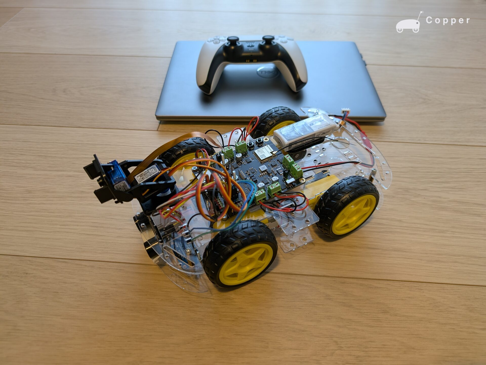
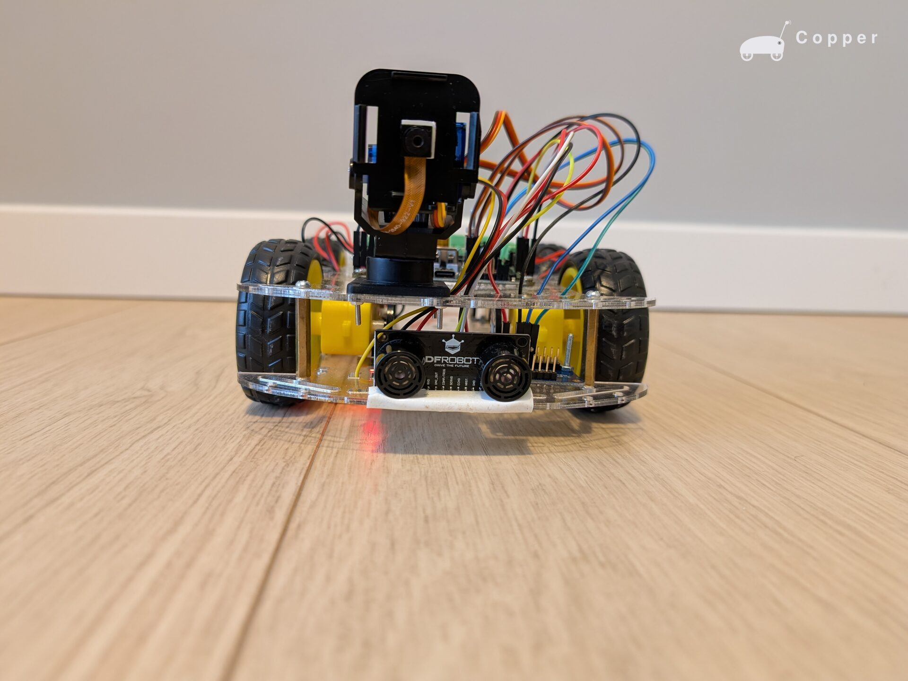
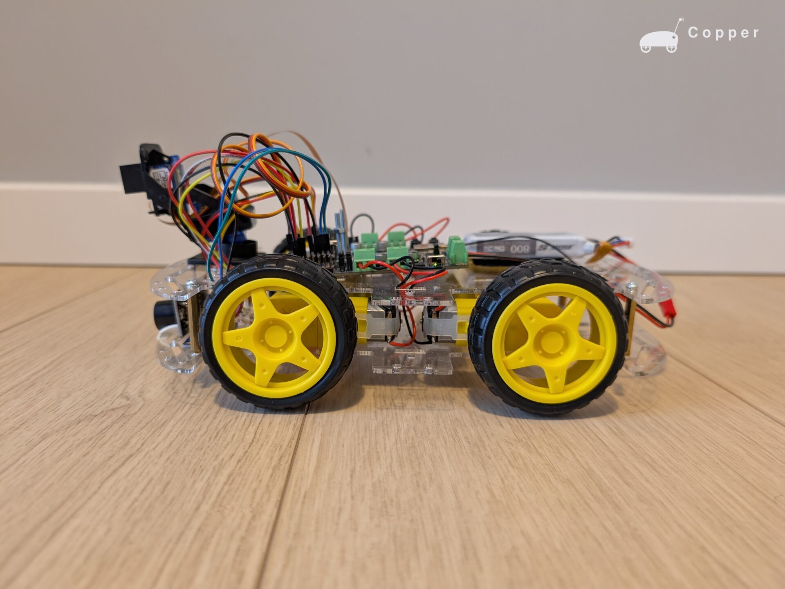
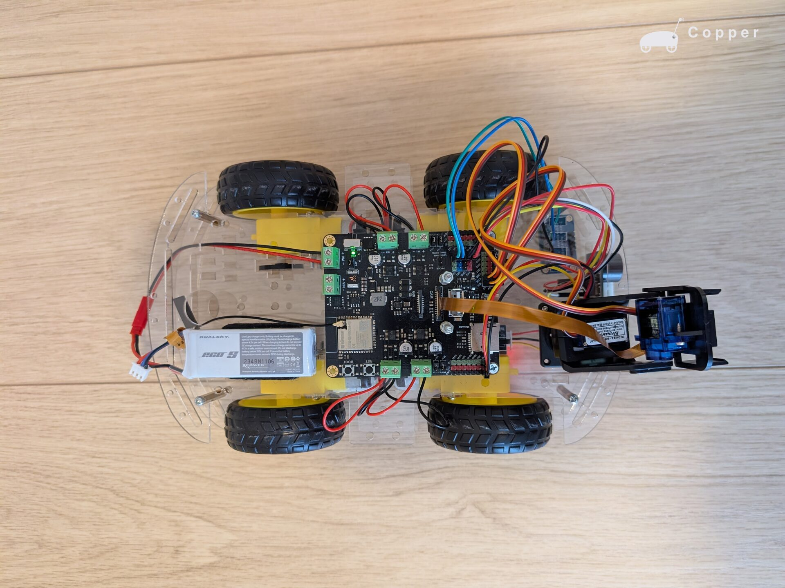
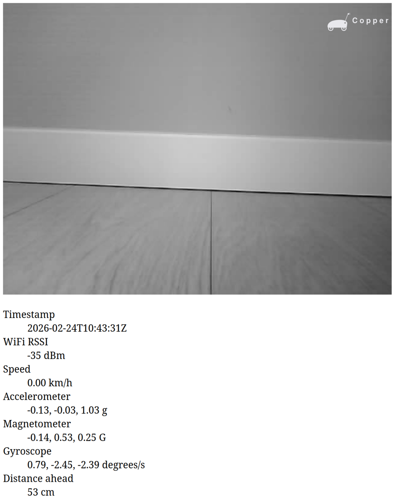
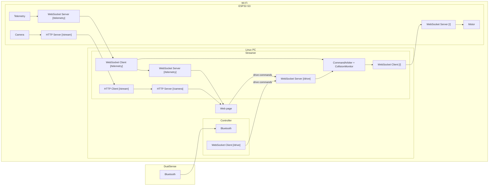

# Copper

`Copper` is a dust-mite variant built around an ESP32-S3 4WD chassis platform, with host-side control and visualization running on Linux. The ESP32 provides control, camera, and telemetry WebSocket endpoints. A Python streamer bridges them to a local browser dashboard, which can drive the car from the keyboard or a gamepad; a Python CLI (DualSense or terminal keyboard) is another way to drive.

## Images

## Bill of materials

| Qty | Item | Link |
| --- | --- | --- |
| 1 | DFRobot Romeo ESP32-S3 | [Product page](https://botland.com.pl/plytki-zgodne-z-arduino-dfrobot/24113-dfrobot-romeo-esp32-s3-plytka-rozwojowa-do-robotow-fpv-rc-car-z-kamera-6959420924127.html) |
| 1 | 4WD rectangular robot chassis | [Product page](https://botland.com.pl/podwozia-robotow/7289-chassis-rectangle-4wd-4-kolowe-podwozie-robota-z-napedem-5904422310127.html) |
| 1 | Waveshare slot sensor 12225 | [Product page](https://botland.com.pl/czujniki-odbiciowe/8834-czujnik-szczelinowy-waveshare-12225-5904422366292.html) |
| 1 | LSM9DS1 9DoF IMU (Adafruit 3387) | [Product page](https://botland.com.pl/czujniki-9dof-imu/8441-lsm9ds1-9dof-imu-3-osiowy-akcelerometr-zyroskop-i-magnetometr-i2cspi-adafruit-3387-5904422336516.html) |
| 1 | URM37 V5 ultrasonic distance sensor | [Product page](https://botland.com.pl/ultradzwiekowe-czujniki-odleglosci/3413-ultradzwiekowy-czujnik-odleglosci-urm37-v5-2-800cm-z-korekcja-temperaturowa-6959420907632.html) |
| 1 | Micro pan-tilt mount | [Product page](https://botland.com.pl/chwytaki-uchwyty-gimbale/3724-uchwyt-do-serw-micro-pantilt-z-miejscem-na-kamere-plastikowy-5904422332167.html) |
| 2 | TowerPro SG-90 micro servo | [Product page](https://botland.com.pl/produkty-wycofane/484-serwo-towerpro-sg-90-micro-180-stopni-5904422329488.html) |
| 1 | Dualsky Li-Pol battery 800mAh 25C 2S 7.4V | [Product page](https://botland.com.pl/akumulatory-li-pol-2s-74v-/2393-pakiet-li-pol-dualsky-800mah-25c-2s-74v-eco-s-6941047104655.html) |
| 1 | Self-adhesive hook-and-loop strap 50x30 mm (5-pack) | [Product page](https://botland.com.pl/rzepy-do-akumulatorow/585-rzep-samoprzylepny-50x30-mm-5-pak-6941047103054.html) |
| 1 | JST-BEC power cable | [Product page](https://botland.com.pl/przewody-i-zlacza-zasilajace/1340-przewod-zasilajacy-z-gniazdem-jst-bec-5904422373047.html) |
| as needed | Connecting cables | — |

## Getting started

- Set up devcontainers as described in [CONTRIBUTING.md](../../CONTRIBUTING.md).
- Pair the DualSense controller as described in [docs/hw/dual_sense.md](../hw/dual_sense.md).
- Enable device passthrough in devcontainers:
	- DualSense for Python container.
	- ESP32 for C++ container.
- Robot setup:
	- Disconnect the battery.
	- Connect the dev board to the PC through USB.
	- Build the firmware and flash the board.
	- Disconnect the USB.
	- Connect the battery.
	- Set JP1 jumper to **ON**.
	- Turn on the robot.
- Host setup:
	- Python devcontainer:
		- In one terminal, run `streamer`.
		- In another terminal, run `controller`. It waits for the streamer, so the two can start in either order.
	- JavaScript devcontainer:
		- Run `./scripts/run_dev_server.sh`.
		- Open `http://localhost:5173` in a web browser (the page connects to the streamer at `ws://localhost:8765`).
- After successful setup, the robot can be driven from the web page (keyboard or a gamepad) or with the DualSense controller, and telemetry plus camera feed can be monitored on the web page.

## HW notes

- **JP1 jumper position:**
	- Battery operation: JP1 must be **ON**.
	- USB connection to the PC: JP1 must be **OFF**.
- **JST-BEC polarity warning:** the connector had inverted wire colors in this setup. Connect **black wire to `+`** and **red wire to `-`** on the development board.
- **USB-only power behavior:** when powered from USB only, the board turns off after some time. When powered from the battery, this issue is not observed.

## SW notes

- In `Copper`, the ESP32 handles motor actuation and exposes three endpoints, each served by its own HTTP server instance on its own port: the Drive endpoint `/` on port 80 and the Telemetry endpoint `/telemetry` on port 82 over WebSocket, and the Camera endpoint `/stream` on port 81 as MJPEG over HTTP (`multipart/x-mixed-replace`), one part per Camera frame with its `traceparent` as a part header ([ADR 0002](../adr/0002-mjpeg-over-http-for-camera-frames.md)). Each instance runs on its own task, so a client that reads the Camera or Telemetry endpoint slowly, or stops reading, does not delay drive commands. A request for an endpoint on another endpoint's port receives HTTP 404. The decision is recorded in [ADR 0001](../adr/0001-one-http-server-per-car-endpoint.md).
- Each endpoint serves one client at a time. While one is connected, the ESP32 refuses another connection to the same endpoint with HTTP 503, before the WebSocket upgrade on the Drive and Telemetry endpoints; the client retries until the first connection has closed. The Camera endpoint notices that its client has gone when sending the next part fails.
- The ESP32 keeps Wi-Fi power saving off (`WIFI_PS_NONE`). With ESP-IDF's default modem sleep, the radio dozes between access point beacons and the car can take several hundred milliseconds to answer, which delays drive commands.
- Steering is skid-steering, with left/right drive commands generated from host-side input.
- On the Linux host, `controller.py` reads PS5 DualSense input and sends commands to the streamer's `/drive` endpoint (`STREAMER_DRIVE_URI`), like the web page, so the same collision monitor applies. Set `CONTROLLER_INPUT_BACKEND=keyboard` to drive from the terminal keyboard instead, without a DualSense controller connected. The CLI connects to `/drive` and, after a failed attempt or a lost connection, tries again every 1 s for as long as it runs, so it survives a streamer restart or a network interruption. Drive commands issued while it is disconnected are dropped, not replayed; it logs one line when the connection is lost and one when it is restored. When the streamer closes the connection with Going Away (1001) or without a close frame, the CLI reconnects; on any other close code, such as 1013 because another driver already holds `/drive` or 1008 for a wrong path, it exits with the streamer's reason at once, even while no Drive command is being sent. In the curses window of the keyboard backend, log lines are written between key reads, and log lines still queued when the CLI exits are written to the console after the window closes.
- On the Linux host, `streamer.py` reads Camera frames as MJPEG from `STREAM_CLIENT_URI`, continuing the car's trace from each part's `traceparent`, telemetry from `TELEMETRY_CLIENT_URI`, processes frames with OpenCV, and serves them to Viewers as MJPEG on `http://localhost:8766/camera` (port `STREAMER_CAMERA_PORT`), one part per Camera frame with its `traceparent` as a part header. It serves the other channels from a local WebSocket server with one endpoint each: `ws://localhost:8765/telemetry` (telemetry) and `ws://localhost:8765/drive` (drive commands in).
- `streamer.py` accepts drive commands on `ws://localhost:8765/drive` from one driver at a time, closing any other `/drive` connection with code 1013 (try again later), and forwards them to the car's Drive endpoint at `DRIVE_CLIENT_URI` through a collision monitor, which turns `ADVANCE` into `BRAKE` while `distance_ahead` is below 5 cm, until it is at least 10 cm again, and publishes whether it is stopping the car on `/telemetry` as a `collision_monitor` WebSocket message. It holds one connection per car endpoint, shared by every client: the Drive and Telemetry endpoint connections for as long as the streamer runs, and the Camera endpoint connection only while a Viewer watches. It reconnects to a car endpoint 1 s after a failed attempt or a closed connection. Drive commands that arrive while the Drive endpoint connection is down are dropped, not queued, and while it is up only the newest unsent one is kept.
- The web page served by the JavaScript devcontainer shows the processed Camera stream in an `` whose `src` is `VITE_CAMERA_URL`, and opens `/telemetry` on the streamer for live telemetry.
- The web page also drives the car over the streamer's `/drive` endpoint: W/A/S/D to drive and the arrow keys to pan and tilt the camera from the keyboard, or a DualSense or similar controller through the Gamepad API. It sends the held command every 100 ms, then `BRAKE` once when every key is released or the page loses focus. If the streamer refuses or drops `/drive`, the page shows why it is not driving.

### Metrics

Sensor and pipeline-health metrics are exported via OTLP and available in Grafana via Prometheus.

**Firmware metrics** (enabled by `CONFIG_ESP_OPENTELEMETRY_METRICS_ENABLED`):

Each firmware component owns its metrics in a dedicated `*_metrics.cpp` file.

[car/components/tracing/system_metrics.cpp](../../car/components/tracing/system_metrics.cpp) — ESP32 system health:

| Metric | Unit | Description |
|---|---|---|
| `dust_mite_free_heap_bytes` | By | ESP32 free heap |
| `dust_mite_min_free_heap_bytes` | By | Minimum free heap since boot (watermark) |
| `dust_mite_largest_free_block_bytes` | By | Largest contiguous free heap block (fragmentation indicator) |
| `dust_mite_internal_free_heap_bytes` | By | Free internal SRAM heap |
| `dust_mite_free_psram_bytes` | By | Free PSRAM (SPIRAM) |
| `dust_mite_uptime` | s | Uptime since boot |
| `dust_mite_temperature` | Cel | ESP32-S3 die temperature |
| `dust_mite_task_cpu_usage` | % | Per-task CPU usage between the last two task stats refreshes (`CONFIG_SYSTEM_METRICS_TASK_STATS_REFRESH_MS`); `task` and `core` attributes identify each series |
| `dust_mite_task_priority` | 1 | Current FreeRTOS priority per task; `task` and `core` attributes identify each series |
| `dust_mite_task_stack_min_free_bytes` | By | Minimum free stack per task since the task started; `task` and `core` attributes identify each series |

`dust_mite_largest_free_block_bytes` and the three `dust_mite_task_*` metrics are off by default. [car/sdkconfig.defaults.debug](../../car/sdkconfig.defaults.debug) enables them through `CONFIG_SYSTEM_METRICS_LARGEST_FREE_BLOCK_ENABLED` and `CONFIG_SYSTEM_METRICS_TASK_STATS_ENABLED`.

[car/components/telemetry/telemetry_metrics.cpp](../../car/components/telemetry/telemetry_metrics.cpp) — sensor readings:

| Metric | Unit | Description |
|---|---|---|
| `dust_mite_rssi` | dBm | WiFi RSSI |
| `dust_mite_speed` | km/h | Car speed from encoder |
| `dust_mite_distance_ahead` | cm | HC-SR04 ultrasonic distance |
| `dust_mite_accelerometer_{x,y,z}` | g | LSM9DS1 accelerometer |
| `dust_mite_magnetometer_{x,y,z}` | G | LSM9DS1 magnetometer |
| `dust_mite_gyroscope_{x,y,z}` | deg/s | LSM9DS1 gyroscope |

[car/components/camera/camera_metrics.cpp](../../car/components/camera/camera_metrics.cpp) — camera pipeline:

| Metric | Unit | Description |
|---|---|---|
| `dust_mite_camera_frames_captured` | {frame} | Camera frames captured (counter) |
| `dust_mite_camera_frame_size_bytes` | By | Peak delivered JPEG frame size since last collection (gauge) |
| `dust_mite_camera_frame_buffer_bytes` | By | JPEG frame-buffer capacity / drop limit (gauge) |

[car/components/web_server/web_server_metrics.cpp](../../car/components/web_server/web_server_metrics.cpp) — endpoint delivery:

| Metric | Unit | Description |
|---|---|---|
| `dust_mite_camera_frames_sent` | {frame} | Camera frames sent on the Camera endpoint (counter) |

**Controller package metrics** (emitted by [controller/src/controller/metrics.py](../../controller/src/controller/metrics.py)):

| Metric | Unit | Description | Emitted by |
|---|---|---|---|
| `dust_mite_camera_frames_processed` | {frame} | Camera frames processed (counter) | `dust-mite-streamer` |
| `dust_mite_viewer_camera_frames_sent` | {frame} | Camera frames sent to viewers, summed over viewers (counter); each `streamer.send_camera_frame` span carries the viewer's `client.address` | `dust-mite-streamer` |
| `dust_mite_telemetry_messages_received` | {message} | Telemetry messages from the car (counter) | `dust-mite-streamer` |
| `dust_mite_commands_sent` | {command} | Drive commands sent, attributed by `command.name` (counter) | `dust-mite-streamer`, `dust-mite-controller` |
| `dust_mite_commands_blocked` | {command} | Drive commands the collision monitor replaced with `BRAKE`, attributed by the requested `command.name` (counter) | `dust-mite-streamer` |

`dust_mite_commands_sent` from `dust-mite-streamer` counts every command
the streamer sends to the car, from any `/drive` client, after the collision
monitor. From `dust-mite-controller` it counts what the CLI sends to the
streamer, before the collision monitor, so the CLI's commands appear under
both services; split them on `service_name`. A run of `BRAKE` between two
identical steering commands from `dust-mite-controller` means the input
backend read a still-held key as released. Each `BRAKE` the collision
monitor substitutes for an `ADVANCE` is also counted in
`dust_mite_commands_blocked`, and its `streamer.handle_drive_command` span
carries both `requested_command_name` and `command_name`.

### Components

